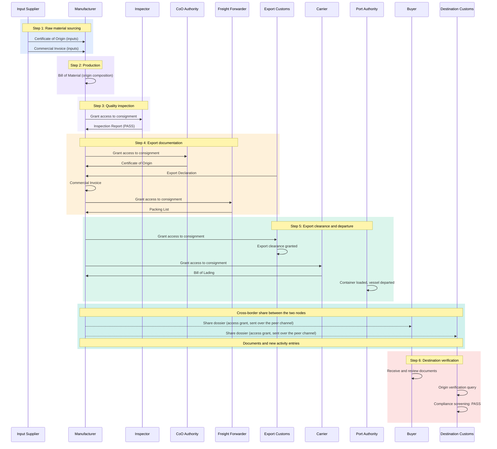

# Trade Corridor Demo Guide

> All organisations, people, addresses, documents and figures in the shipped corridor configs are fictitious, and any resemblance to real companies or authorities is coincidental. Countries, ports, laws and trade agreements are real, and their mention implies no involvement or endorsement by the governments or organisations concerned.

This is the click-level script for presenting the demo. The examples use the default corridor, `configs/vietnam-us-customs.json`. Other corridors follow the same steps with their own organisations and documents, but only this corridor has the customs views (Customs Desk, Customs Review, Import Pre-clearance). The argument behind the customs demo, its personas and what to say about scope are in [docs/customs-demo-storytelling.md](docs/customs-demo-storytelling.md).

## Before you present

You need Node.js 24 or later. Install and start commands are in the [README](README.md), and the docker-mode runbook is [docs/running-the-demo.md](docs/running-the-demo.md). The short version:

```bash
npm install
ADAPTER_MODE=simulated npm run demo   # no TWIN nodes needed
```

`ADAPTER_MODE` defaults to `docker`, so a plain `npm run demo` expects TWIN nodes on `http://localhost:3000` (Alpha) and `:3001` (Beta). A TWIN node is the server that provides identities, document notarization, document storage and access policies, and writes its proofs to the IOTA network ([docs/twin-node-overview.md](docs/twin-node-overview.md)). Without the nodes the demo servers still start, but every call to a node fails. Use docker mode only after the runbook's first-time setup (wallets, funding, anchoring) and its per-corridor provision and seed steps, with the same `CONFIG_FILE` exported for provisioning, seeding and the demo. To present another corridor in simulated mode, prefix the start command with its config, for example `CONFIG_FILE=configs/cambodia-eu.json`. The shipped corridors are the JSON files in `configs/`: `vietnam-us-customs` (the default), `vietnam-us`, `vietnam-eu`, `cambodia-eu` and `adapt-africa`.

`npm run demo` starts Node Alpha (export side) on http://localhost:4000, Node Beta (import side) on http://localhost:4001 and a routing proxy on http://localhost:4002, which serves either node through `?node=alpha` or `?node=beta`. The proxy remembers the choice in a per-browser cookie, so two proxy tabs in the same browser end up talking to the same node. To act as Alpha and Beta at the same time, use ports 4000 and 4001 in two tabs, or the proxy in two different browsers or browser profiles.

The adapter mode changes what the audience sees. The customs demo is meant for docker mode, because its verification beats rely on documents anchored on the IOTA testnet: the TWIN node signs a proof that includes each document's SHA-256 fingerprint and records it on the testnet, so anyone can later check that a file is unchanged.

| On screen | `simulated` | `docker` |
|---|---|---|
| Organisation identity (DID, a decentralized identifier) | No DIDs unless `data/seed-state.json` holds a docker seed of this corridor, so a private organisation sees **Register DID** and cannot upload until it registers | Every seeded private organisation shows **Verified** with a `did:iota:testnet:0x...` DID on Identity. Public authorities show an Attestation Authority card, and their DIDs appear in the other node's Peer Node Organisations table once the nodes are connected |
| Document badge | "Demo mode" | "On ledger", "Verified on ledger" after a check, "On peer ledger" on the receiving node |
| Customs dossier checklist | "No provenance" on documents that require notarization, no **Verify all** button | Anchored documents with **Verify** and **Verify all** |
| `VN-2026-EXP-00104` (the emailed-PDF case) | "Unverified (emailed PDFs)" and a "Today's reality" banner. `VN-2026-EXP-00107` shows the same label and banner, because its config also sets `dossierVerified: false`: ignore them in Beat 2 | "Verified dossier": the seed anchors this consignment's documents like all the others, so only the yellow channel and the **→ GREEN if verified** badge carry the story |
| Cross-node share | Sent over the WebSocket peer channel only | Also creates an access policy on Alpha's TWIN node and opens a Federation Receipt. The share can take several seconds |
| Public verify page | "Demo mode" banner. The file fingerprint check still works | Live verification and an IOTA explorer link |
| Analytics (the activity log) | In memory, reset on restart | Read from the TWIN node's auditable item stream (AIS), survives a restart. Entries copied from the other node are held only in memory |

QR codes shown on screen encode the address your browser is using. QR codes printed inside PDFs (the seeded invoice and packing list, the draft import declaration and the Transport Pass) encode `PUBLIC_BASE_URL`, which defaults to `http://localhost:4002`. A phone can only open either kind if that host is reachable from the phone, for example through a tunnel. In docker mode set `PUBLIC_BASE_URL` before `twin:seed` and keep it for the demo servers: the URL is printed into the anchored PDFs, so changing it afterwards makes the original files fail the fingerprint check. A tunnel makes the whole demo public, including endpoints that hand out TWIN node and organisation credentials without a login and let anyone spend wallet funds, so read [the tunnel warning](docs/running-the-demo.md#exposing-the-demo-through-a-tunnel) first and close the tunnel after the session. Without a tunnel, click the link printed under the on-screen QR to open the same page on your machine.

## Which demo to run

For a customs audience, run the [customs demo](#customs-demo-one-dossier-two-declarations) (Beats 0-7, 15-20 minutes). For any other audience, run the main demo and add the additional demos as time allows:

| Time | Content |
|---|---|
| 5 min | Main demo |
| 10 min | Main demo and error cases |
| 15 min | Main demo, trade finance and error cases |
| 30 min | Main demo and all additional demos |

## Logins

All passwords are `demo`. The login page's Quick Sign-In lists every organisation of the node you opened. Clicking a row fills in the form, and you still press **Sign In**. An organisation can only log in on its own node.

Node Alpha (http://localhost:4000):

| Username | Organisation | Role in config | Extra page |
|---|---|---|---|
| `lotusbay` | Lotus Bay Apparel JSC | Manufacturer - Vietnam | |
| `vncustoms` | Export Customs Office (Vietnam) | Customs Authority - Vietnam | Customs Desk |
| `vncoo` | Certificate of Origin Office (Vietnam) | Certificate of Origin Authority - Vietnam | |
| `hanbit` | Hanbit Fibers Co., Ltd | Input Supplier - South Korea | |
| `financier1` | Mekong Commercial Bank | Financier - Vietnam | |
| `financier2` | Meridian Trade Bank Vietnam | Financier - International | |
| `clearview` | Clearview Inspection Services Vietnam | Quality Inspector - Vietnam | |
| `hcmcport` | Port Authority (Ho Chi Minh City) | Port Authority - Ho Chi Minh City | |
| `jadeway` | Jadeway Logistics | Freight Forwarder - Vietnam | |
| `bluewave` | Bluewave Container Line Vietnam | Carrier - Vietnam | |

Node Beta (http://localhost:4001):

| Username | Organisation | Role in config | Extra page |
|---|---|---|---|
| `northpeak` | Northpeak Athletics Inc. | Importing Buyer - United States | Import Pre-clearance |
| `northpeakeu` | Northpeak Athletics Europe B.V. | Importing Buyer - EU | Import Pre-clearance |
| `uscustoms` | Import Customs Office (United States) | Customs Authority - United States | Customs Review |
| `eucustoms` | EU Import Customs Office (Netherlands) | Customs Authority - EU | Customs Review |

The extra page is driven by the organisation's `customsDeskRole` in the config and appears in the sidebar after Consignments. The other sidebar pages are Dashboard, Network, Consignments, Payments, Trade Finance, Identity, Access Control and Analytics.

## Main demo

Everything is pre-loaded, so no uploads or data entry are needed. In the customs corridor all six consignments belong to Lotus Bay Apparel on Alpha, and Beta starts empty.

### Part 1: export side

1. Open Alpha and log in as the manufacturer (`lotusbay`).
2. **Dashboard**: the Active Consignments, Trade Volume and Ledger Events cards, the Recent Consignments table and the Recent Activity feed (the latest entries of the activity log). Do not present the Entity Trust Score (a fixed 87 once any organisation on the node is verified) or the documents pill (always out of 6, while each consignment of this corridor has 5 documents) as computed values.
3. **Consignments**: click `VN-2026-EXP-00101` and walk through its documents, each with its issuer and badge.
4. **Access Control**: the matrix of consignments and organisations. The owner holds a crown cell, and the seed pre-grants read access on every customs-corridor consignment to the export customs office and the certificate of origin office.

### Part 2: connect the nodes

5. Open **Network** and click **Connect to peer**, then **Connect** on the Node Beta row of the "Discover & Connect to Nodes" dialog. The Node Status card on the Dashboard has the same **Connect** button. Ignore the address on the row (`127.0.0.1:3991` on Alpha): it is computed for display and no service listens there.
6. Wait for **Peer connected**. Beta's organisations now appear as peer organisations.

The nodes do not connect on their own, and the link is not re-established after a server restart.

### Part 3: cross-border share

7. Back in **Consignments**, open `VN-2026-EXP-00101` and click **Share**.
8. Keep **All documents** selected and click **Share** on the buyer's row (Northpeak Athletics Inc., whose role line ends in "Node Beta").
9. In simulated mode the row's button changes to **Revoke** and you can share with the destination customs row, Import Customs Office (United States), in the same dialog. In docker mode the dialog turns into the Federation Receipt after the first share: close it, click **Share** again and share with the customs row.
10. Beta receives the consignment and its documents immediately over the WebSocket peer channel, and its notification bell lights up. From then on, every new activity entry on either node is copied to the other while the link is up.

In docker mode the Federation Receipt shows three steps: access granted, delivered over the data space, received on Node Beta. The first is real: the share created an access policy on Alpha's TWIN node, written in ODRL (the W3C policy language TWIN uses for access rules). The data itself travelled over the peer channel. The delivery steps turn green because Alpha sees the consignment appear in Beta's node, which Beta wrote after receiving it over the link. Alpha checks for about 9 seconds, so if Beta's node is slower the last two steps show as not completed even though Beta already has the data, which you can confirm on Beta. The receipt's own text says the consignment went through the Dataspace Protocol (DSP, the Eclipse standard for catalogue, contract negotiation and transfer between data-space connectors) and calls the share a protocol exchange. Say instead that the access policy is real and the data travelled over the peer channel between the two demo servers. [docs/dsp-design.md](docs/dsp-design.md) explains why the protocol delivery does not complete on TWIN node 0.9.0.

### Part 4: destination

11. Open Beta and log in as destination customs (`uscustoms`).
12. **Consignments**: open the received consignment, marked "Shared from Alpha", and walk through the same documents.
13. **Analytics**: Beta's activity log. While the link is up, each new entry recorded on Alpha is copied here as it happens. In docker mode the page first loads from Beta's own TWIN node, which does not store Alpha's entries, so Alpha's share entries appear only after the next new entry on either node. To show them arriving, log in on Beta before you share in Part 3 and keep Analytics open.

## Customs demo: one dossier, two declarations

Eight beats, 15-20 minutes. The storytelling doc explains what each beat argues and what to say when asked about scope. Run it in docker mode if you can (see the table in [Before you present](#before-you-present)), and connect the nodes as `lotusbay` before you start, as in Part 2.

### Beat 0: the "before"

Thirty seconds, no clicks. State the starting point: today the supporting documents of a declaration arrive as emailed PDF scans, so authenticity is taken on trust and every value is typed in again. Every later beat contrasts with this.

### Beat 1: the officer's queue

1. On Alpha, log in as `vncustoms` and open **Customs Desk**.
2. The queue lists six export declarations filed by Lotus Bay Apparel, each with a 12-digit declaration number, its UCR (unique consignment reference), goods, channel and dossier state. The channel is the customs risk engine's routing decision: green is released on the data, yellow goes to document review, red to physical inspection. The cards count 3 green, 2 yellow and 1 red, next to fixed reference base rates (66%, 30.3%, 3.4%) and clear times (same day, 1-3 working days, physical inspection).
3. Open `VN-2026-EXP-00101`: green channel, release pending, dossier verified. The detail adds the declaration type (B11, the code for an ordinary commercial export), customs office, trader tax code, container and seal. The declaration date is fixed in the config (12 June 2026). Go back with **Back to queue**.
4. Point at `VN-2026-EXP-00104`, yellow, with the **→ GREEN if verified** badge. Its supporting documents are the ones that arrived by email. Make the point that verified documents feed the authority's risk engine, while the channel decision stays with the authority.

### Beat 2: what provenance cannot fix

5. Open `VN-2026-EXP-00107` (red, physical inspection scheduled). The origin composition card shows 58% local content against a 55% threshold, in red, because the cotton fabric line (34% of value, supplier country UNDECLARED) is marked **NO INPUT C/O**.
6. The declared percentage clears the threshold, but the evidence behind it is missing. Anchoring a document proves it was not altered, not that its content is true, so this declaration stays red in every mode.
7. Open `VN-2026-EXP-E001` (yellow). The HS Code Mismatch banner shows the export declaration filed under HS 6205.30 while the invoice says 6205.20. Shared, verified data surfaces this kind of inconsistency earlier, but it is a data error, not a provenance gap.

### Beat 3: the certificate of origin and the paper rule

8. Open `VN-2026-EXP-00103`, the only EU-bound declaration (the queue marks it **EUR.1 paper**). EUR.1 is the certificate that proves preferential (reduced-duty) origin for goods entering the EU. The certificate of origin card says that above EUR 6,000 the printed EUR.1 is still the legal instrument, so the digital copy is evidence, not a legal equivalent.

### Beat 4: one dossier crosses the border

9. On Alpha as `lotusbay`, share `VN-2026-EXP-00101` with Northpeak Athletics Inc. and with Import Customs Office (United States), as in Part 3. Skip this step if you already shared it in Part 3 since the last server restart.
10. On Beta, log in as `northpeak` and open **Import Pre-clearance**. If the list is still empty, click **Check again**.
11. Open `VN-2026-EXP-00101`. The dossier checklist lists each supporting document with its issuer. In docker mode click **Verify all**, which re-checks each document's notarization proof live (how a proof anchored on Alpha is checked from Beta is described in [docs/document-verification.md](docs/document-verification.md)). Shared documents keep the verification state they had on Alpha, so if they were already verified there, every row shows verified and the button is hidden.
12. Below it, the import declaration is pre-filled from the dossier: 17 fields for this consignment, each tagged with the document it came from (commercial invoice, packing list, export declaration, certificate of origin, bill of lading). Only the importer's own fields remain: entry filer code, customs bond number and port of entry code (EORI, office of lodgement and VAT number for an EU-bound consignment).
13. Click **Accept pre-lodged data**. A draft import declaration (`IMD-00101`) is created, and the "Pre-lodged Data Accepted" entry appears in the activity log of both nodes. **Request correction** sends a reason back to the exporter's activity log instead.
14. Optionally sign out and log in as `uscustoms`: **Customs Review** shows the same dossier from the reviewing authority's side.

### Beat 5: verification without an account

15. Download the commercial invoice or packing list PDF from the consignment's document list (Consignments page). It carries a verification QR at the bottom right.
16. Scan it, or click **QR** on a document row for an on-screen code and open its link. The public verify page needs no login and shows the issuer, the registered SHA-256 fingerprint and, in docker mode, the live check and the IOTA explorer link.
17. Under **Check a file against this record**, select a different file or a copy of the PDF with one byte changed: the page shows **Fingerprint MISMATCH**. The original file gives a fingerprint match. The hash is computed in the browser and nothing is uploaded.

### Beat 6: system to system

18. In a terminal, while the demo runs:

    ```bash
    node scripts/customs-system-simulator.mjs --ref VN-2026-EXP-00101
    node scripts/customs-system-simulator.mjs --ref VN-2026-EXP-00107   # the red case
    ```

    The script plays a customs declaration system: it calls `GET /api/verify/consignment/<ref>` on Alpha with the service token `demo-customs-integration`, prints each document's verification state and a channel recommendation, and states that the decision belongs to the authority.
19. Show the API description at http://localhost:4000/api/verify/docs. This is the surface a national system would call instead of receiving emails.

### Beat 7: the driver at the checkpoint

20. On Beta, open `VN-2026-EXP-00101` in **Import Pre-clearance** (as `northpeak`) or **Customs Review** (as `uscustoms`) and click **Shipment QR**. The button is also in the Consignments detail, the Customs Desk detail and the Dashboard's consignment panel. Use the node where you ran **Verify all**, because the pass counts verifications per node.
21. Optionally click **Print transport pass**: a one-page PDF with the UCR, parties, goods with HS code, origin, customs value, status and channel, "N documents (M verified)" and a large QR. In docker mode M counts only the documents verified on the node that prints the pass since its server started.
22. Scan the QR or open its link. The public `/shipment/:id` page needs no login and shows this one shipment: parties, goods, customs value, origin and its evidence, the channel and every supporting document with its verification state. Each document has a **Verify →** link to its public verify page, and documents whose type allows it can be opened in full. Payments, finance and other shipments are not shown.
23. The link works as a bearer capability: whoever holds it sees the shipment view, and in this demo it never expires. For seeded consignments the id in the link is `seed-` followed by the UCR, so the link can also be guessed. The dialog points out the bearer nature, and a production version would need signed links with expiry and revocation.

If someone asks whether the public pages are a TWIN node feature: no. The QR pages and the per-document-type rule that decides whether a document's content or only its verification is public live in the demo server, not in the TWIN node. Details are in [docs/document-verification.md](docs/document-verification.md).

## Additional demos

### Digital identity

**Register DID** appears only for a private organisation without a DID, which in practice means simulated mode without a `data/seed-state.json` entry for this corridor (see the table in [Before you present](#before-you-present)). Government organisations get an Attestation Authority card instead of the button.

1. Log in on Alpha as `lotusbay`, open **Identity** and click **Register DID**.
2. Enter a code that fails and press **Verify & Register**: `MST-000000` (denied), `MST-111111` (expired), `MST-222222` (suspended), any code starting with `X` or `0`, or one shorter than 6 characters. The steps stop at the failing check. Click **Try Again**.
3. Enter a code that passes (`MST-123456`, `KBN-254789`, `EIN-123456` or `EORI-123456`) and watch the five verification steps complete.

The page lists example codes under Credential Validation Rules. The check is a rule lookup against the config in every mode, although the steps are labelled as registry queries. The result is a synthetic `did:iota:0x...` in simulated mode. In docker mode, registration creates a real testnet identity and spends testnet funds.

### Trade finance

Log in on Alpha as `lotusbay` and open **Trade Finance**. The Letters of Credit tab has the seeded LC for `VN-2026-EXP-00101`. The Smart Contracts tab has a contract with four release conditions, two of them already met. Click **Mark Met** on the other two (only the contract's creator, the payee Lotus Bay Apparel, sees the button), and the payment releases automatically because the contract has auto-release on. Finance runs in memory in every mode, so present it as a simulation of how payment could follow verified documents.

### Error cases

Each corridor seeds at least one consignment with an error. The consignment list marks it with a warning icon next to the status, and its detail shows the error type as a pill and a Reconciliation Alert. In the customs corridor this is `VN-2026-EXP-E001` (HS Code Mismatch). The "Origin Verification Failed" case exists in `cambodia-eu` and `vietnam-eu`. `VN-2026-EXP-00107` is red for incomplete origin evidence, but it carries no error type.

### Analytics

Open **Analytics** on either node and filter by All Events, Identity, Documents, Permissions or Network. Finance, payment and logistics entries appear only under All Events. Each entry shows time, type, action, details, actor and an entry hash. That hash is a random identifier, not a hash of the entry. Document SHA-256 fingerprints are in each document's badge and on the public verify page. Ignore the page subtitle, which claims that every event is anchored on "IOTA Mainnet": docker mode uses the IOTA testnet, entries copied from the other node are held only in memory, and simulated mode anchors nothing.

## Background: the trade flow behind the seed data

The seeded consignments and documents stand for the flow below. It is conceptual: each corridor config lists the documents it actually seeds under `documents`, and the customs corridor seeds five per consignment (certificate of origin, export declaration, commercial invoice, packing list, bill of lading).



## Questions the audience asks

**Where is the data stored?** Documents stay with the node of the organisation that owns them and reach the other node only when the owner shares their consignment. The activity log is the exception: while the peer channel is up, every new entry on either node (shares, uploads, status changes and finance actions, with UCRs and amounts) is copied to the other node and shown on its Analytics page, whether or not the consignment was shared. In docker mode DIDs, notarization proofs, consignments and each node's own activity log are written to that side's TWIN node, and proofs are anchored on the IOTA testnet. In simulated mode everything lives in the demo server's memory and resets on restart. [docs/architecture.md](docs/architecture.md) lists what survives a restart in each mode.

**Is this on the real IOTA blockchain?** In docker mode it writes to the public IOTA testnet, not to mainnet, and the verify pages link to the public explorer. In simulated mode nothing is written to a ledger. Simulated mode only shows real testnet DIDs if an earlier docker seed of the same corridor left them in `data/seed-state.json`.

**How does this connect to real government systems?** The demo shows the pull direction: a declaration system calls the verify API (Beat 6). Pushing data from a national system into TWIN is not implemented in this repository.

**What about data sovereignty and access control?** Export-side documents stay on Alpha until the owner shares them, and the owner can revoke a share from Access Control. Activity log entries are not filtered this way (see the first question). In this demo the server trusts the organisation ids the browser sends and leaves read endpoints open, and in docker mode each demo server holds the other node's admin login and API key. Access control is therefore a demonstration, not an enforced security boundary. [docs/authentication-architecture.md](docs/authentication-architecture.md) has the details.

**Why two nodes?** In the target design each country runs its own node, and no central server sees all the data. In this demo both TWIN nodes run on the same machine, and in docker mode each demo server holds the other node's credentials. Cross-border transfer runs over a WebSocket peer channel between the two demo servers in both modes. In docker mode a share also records an access policy on the owner's TWIN node, and delivery over the Dataspace Protocol does not complete on TWIN node 0.9.0 ([docs/dsp-design.md](docs/dsp-design.md)).

**Can this work for other corridors?** Yes. Organisations, documents, branding and map come from the corridor config, so switching corridors means pointing `CONFIG_FILE` at another config and restarting, plus provisioning and seeding in docker mode ([docs/running-the-demo.md](docs/running-the-demo.md)). The customs views need a config with `customsDeskRole` entries, which only `vietnam-us-customs` has today.

## Troubleshooting

| Symptom | Fix |
|---|---|
| Port already in use | `lsof -ti:4000 \| xargs kill` (same for 4001 and 4002) |
| Register DID fails with "TWIN Node unavailable", the boot log shows "Adapter warm-up failed (docker)" | The servers run in docker mode without TWIN nodes. Start with `ADAPTER_MODE=simulated` or bring the nodes up |
| No Customs Desk, Customs Review or Import Pre-clearance | The active config is not `configs/vietnam-us-customs.json` |
| Docker mode shows "Demo mode" badges | The seed did not run, or `CONFIG_FILE` differs from the one used for `twin:seed`, so the server ignores the seed state |
| **Peer connected** never appears after **Connect** | The other demo server is not running. `npm run demo` starts both, so check its log |
| Beta's organisations are missing from the Share dialog, which shows a "Peer node offline" banner | The nodes are not connected. Connect from Network (Part 2), then reopen Consignments. Reconnect after any server restart |
| The Consignments page is empty for an organisation | It owns no consignment and none was shared with it. In the customs corridor only `lotusbay`, `vncustoms` and `vncoo` see the seeded consignments on Alpha. As `lotusbay`, grant access from Access Control or with **Share** |
| Import Pre-clearance or Customs Review is empty | The consignment was not shared with that organisation, or a server restart dropped the share. Reconnect (Part 2), share again from Alpha, then click **Check again** |
| Two proxy tabs show the same node | The proxy routes by a per-browser cookie. Use ports 4000 and 4001, or two browsers |
| Page reload shows the login screen | Expected: the logged-in organisation is held in page memory |
| Login fails | Passwords are `demo`, and each organisation logs in only on its own node |
| A phone cannot open a scanned QR | The QR points at localhost. Open the demo through a tunnel for on-screen codes, and set `PUBLIC_BASE_URL` to the tunnel address for codes printed in PDFs, after reading [the tunnel warning](docs/running-the-demo.md#exposing-the-demo-through-a-tunnel). In docker mode set it before `twin:seed` and keep it for the servers, because it is printed into the anchored PDFs |
