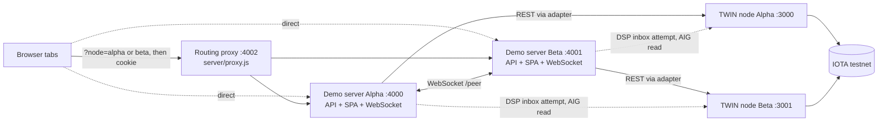
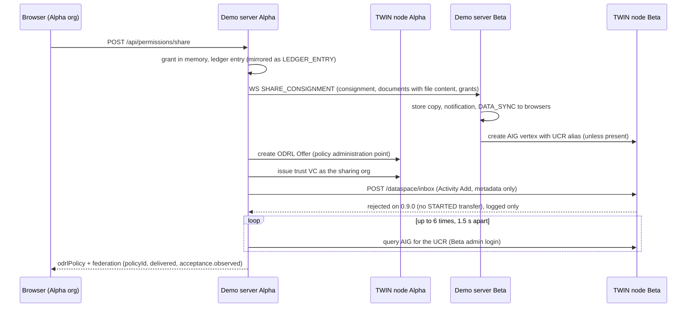

# Architecture and node communication

The demo runs two copies of the same Node.js server, one per trade party: **Alpha** (export side) and **Beta** (import side). Each demo server serves the React single-page app, a REST API under `/api` and a WebSocket endpoint, and keeps its working state in memory. In docker and hosted mode each demo server is also backed by its own TWIN node, a ready-made server (Docker image `twinfoundation/twin-node:0.9.0`) that provides decentralised identifiers (DIDs), notarization on the IOTA testnet, document storage, audit records and access policies in ODRL (the W3C Open Digital Rights Language) over REST. [twin-node-overview.md](twin-node-overview.md) describes what a TWIN node offers. There is no shared database and no central server: each party's records reach the other over the peer channel described below, which is how the demo models two jurisdictions exchanging trade documents. One demo shortcut breaks that separation. In docker mode both demo servers run from one checkout, read the same `data/tenant-state.json`, and each holds the other TWIN node's admin login and tenant API keys, which it uses to post to that node's inbox and read its consignments (see [The DSP attempt](#the-dsp-attempt-docker-mode)).

Below, "demo server" means the Node.js process and "TWIN node" the container behind it. Record fields such as `originNode` and `notarizationNode` hold the side (`alpha` or `beta`) that created the record.

The dotted browser edges are the alternative to the proxy: a browser can open a demo server's port directly. The dotted edges from a demo server to the other side's TWIN node exist only in docker mode and are explained under [The DSP attempt](#the-dsp-attempt-docker-mode). In docker mode the TWIN nodes run locally on ports 3000 and 3001, in hosted mode at remote URLs. How to start the stack is in [running-the-demo.md](running-the-demo.md).

## Processes and ports

| Process | Port | Started by | Notes |
|---|---|---|---|
| Demo server Alpha | 4000 | `npm run node:alpha` | Listens on all interfaces. The HTTP API, the SPA, the browser WebSocket and the peer WebSocket (`/peer`) share this port. |
| Demo server Beta | 4001 | `npm run node:beta` | Same as Alpha. |
| Routing proxy | 4002 (`PROXY_PORT`) | `npm run proxy` | Listens on all interfaces. Forwards HTTP requests and WebSocket upgrades on any path to Alpha or Beta. |
| TWIN node Alpha | 3000 | `npm run twin:up` (`docker-compose.twin.yml`) | Published on 127.0.0.1 only. Its MySQL is on 127.0.0.1:3306. |
| TWIN node Beta | 3001 | `npm run twin:up` | Published on 127.0.0.1 only. Its MySQL is on 127.0.0.1:3307. |

`npm run demo` builds the client and the TWIN client wrapper, then starts both demo servers and the proxy. `npm start` and `npm run dev` are identical: both build, then start the two demo servers without the proxy and without hot reload. `npm run dev:client` runs the Vite dev server on port 3000, so it cannot run next to TWIN node Alpha, and it proxies only `/api` to Alpha (no WebSocket, no `/twin`, no Beta).

Each demo server takes its identity from CLI flags or environment variables (`server/store.js`):

| Flag | Environment variable | `node:alpha` / `node:beta` pass | Purpose |
|---|---|---|---|
| `--port` | `PORT` | `4000` / `4001` | HTTP port, also used by both kinds of WebSocket |
| `--id` | `NODE_ID` | `alpha` / `beta` | Selects this side's organisations (`nodes.<id>.orgs`) and seeded data in the corridor config, its default TWIN port and its peer TWIN node. Only `alpha` and `beta` are wired through. |
| `--name` | `NODE_NAME` | `Node Alpha` / `Node Beta` | Display name |
| `--peer` | `PEER_URL` | `ws://localhost:4001` / `ws://localhost:4000` | The other demo server, dialled at `PEER_URL + '/peer'` on its HTTP port |
| `--ws` | `WS_PORT` | Not passed (default 4010) | Vestigial: nothing listens on it, and `GET /api/node` only echoes it as `wsPort` |

The environment variable wins when both are set, so a globally exported `PORT` or `NODE_ID` overrides both demo servers started by `npm run demo`. The corridor config is the JSON file under `configs/` that `CONFIG_FILE` selects. It defines the organisations, seeded consignments, document types and branding of one trade corridor, and the [README](../README.md) explains how to choose one.

Writes need the `twin_session` cookie set at login, reads are open, and the logged-in organisation lives in React memory, so a page reload returns to the login screen. [authentication-architecture.md](authentication-architecture.md) covers login, the cookie and what it protects.

### The routing proxy

The proxy (`server/proxy.js`) lets a single public URL, for example a cloudflared or localtunnel tunnel to port 4002, serve both demo servers. For every request it picks a target in this order: a URL containing `node=alpha`, a URL containing `node=beta`, a `twin-node=beta` cookie, otherwise Alpha. The URL check is a plain substring match, so `node=beta` inside any other parameter also routes to Beta. When the URL matches, the response also sets the HttpOnly cookie `twin-node=<alpha|beta>`, so later requests without the parameter stay on that demo server. WebSocket upgrades follow the same rule on every path. `?node=` only selects the proxy target: a demo server reached directly ignores it.

The routing cookie belongs to the proxy's host, so every tab of one browser shares it. Opening `?node=beta` in a second tab silently sends the first tab's next API calls to Beta. To act as two parties at the same time, use two browsers or browser profiles, or open ports 4000 and 4001 directly. On localhost the `twin_session` login cookie is also shared between ports 4000 and 4001, because cookies ignore the port. That is harmless with the default `SESSION_SECRET` (a cookie signed by one demo server validates on the other), but logging out in one tab clears the shared cookie, so the other tab still looks logged in while its next write fails with 401.

## Adapter modes

Every TWIN operation behind the demo's own API goes through an adapter (`server/adapter/`). Two paths call the node URL directly instead: the `/twin/*` proxy with its demo-session and OpenAPI helpers (`server/routes/twin-proxy.js`), and the boot-time version check (`GET {nodeUrl}/` in `server/index.js`). `ADAPTER_MODE` selects the implementation once at boot, for the whole demo server. It defaults to `docker`, so a plain `npm run demo` expects TWIN nodes on ports 3000 and 3001, and an unknown value stops the server at boot. `createAndInitAdapter(mode, nodeId)` in `server/adapter/index.js` builds and initialises the adapter from the `TWIN_<NODE>_*` settings.

| Mode | Backend | Required settings | Cross-node exchange |
|---|---|---|---|
| `simulated` | In memory, random ids, no network | None | WebSocket peer channel only |
| `docker` (default) | TWIN nodes at `http://localhost:3000` (Alpha) and `http://localhost:3001` (Beta), overridable with `TWIN_ALPHA_URL` / `TWIN_BETA_URL` | Node admin login (`TWIN_<NODE>_EMAIL`, `TWIN_<NODE>_PASSWORD`) and tenant API key (`TWIN_<NODE>_API_KEY`), all with working local defaults | WebSocket peer channel, plus the DSP attempt against the peer's TWIN node |
| `hosted` | Remote TWIN nodes | Each demo server requires its own `TWIN_<NODE>_URL` (Alpha `TWIN_ALPHA_URL`, Beta `TWIN_BETA_URL`), and localhost URLs are rejected. Same login and API-key settings as docker. | WebSocket peer channel only. The DSP calls still run but target the sender's own TWIN node, because peer nodes are resolved only in docker mode. |

The admin login defaults to `admin@<node>` with a built-in password that matches `twin/<node>/bootstrap.env`, and the tenant API key defaults to the one the anchor stage of `npm run twin:bootstrap` wrote to `data/tenant-state.json`. The node is multi-tenant: the `x-api-key` header selects the tenant, a partition with its own users and data ([twin-node-overview.md](twin-node-overview.md)). These defaults fit only the local nodes, so set all three for a remote node in hosted mode. In docker mode a TWIN node that is down does not stop the server: the login warm-up only logs a warning, and TWIN-backed requests then fail one by one. `HostedAdapter` extends `DockerAdapter` and differs only in its URL checks.

The adapter contract is `ITwinAdapter` in `server/adapter/base.js`, whose `ITWIN_ADAPTER_METHODS` lists 26 methods. Two more methods are used outside the contract: `listConsignments` (by `server/ws.js` and `server/routes/consignments.js`) and `findConsignmentVertexIdByUcr` (by `server/ws.js`). Only `DockerAdapter` implements them (`HostedAdapter` inherits them), and the callers check for them at run time. A new adapter that implements only the contract therefore runs without errors, but `GET /api/consignments` then serves memory only, the recipient poll does nothing, and replication of a received consignment to the node loses its duplicate check.

`DockerAdapter` talks to the node through `KitsuneClient` (`server/twin/kitsune-client.ts`), a TypeScript wrapper over the `@twin.org/*` 0.9.0 REST clients that `npm run build:twin` compiles to `server/twin/dist`. `server/adapter/index.js` imports the docker adapter unconditionally, so on a fresh checkout `node server/index.js` fails in every mode, simulated included, until that build has run (`npm run build` and `npm run demo` include it).

### Inside the docker adapter

- **What simulated mode returns.** Methods that only mirror local state onto the node (`createAigVertex`, `createAisStream`, `appendAisEntry`, `dspShareConsignment`, `dspRevokeConsignment`, `dspNotifyDocumentUpload`) return `null` in simulated mode, and callers read `null` as "no node, keep the in-memory path". Methods whose result the UI needs (`createDid`, `createImmutableProof`, `createAttestation`, `storeDocument`) return random ids, and `verifyImmutableProof` always returns `true`. A flow that works in simulated mode is therefore not shown to work against a node.
- **One login per client.** Each `KitsuneClient` instance holds one login for one node and one identity: the node admin, one client per organisation that signs its own attestations and trust credentials, and in docker mode a client for the other node. It logs in again when less than 60 seconds of the token's lifetime remain and never calls `/authentication/refresh`. Every call carries `x-api-key`, because a tenant-enabled node resolves the tenant from it on every request, login included.
- **Signing methods on REST-created DIDs.** A DID created with `POST /identity` starts without verification methods, so `DockerAdapter.createDid()` adds `org-assertion` and `attestation-assertion` right after creating it, through the idempotent `ensureVerificationMethod` (each creation is a paid on-chain update). Such a DID has no wallet, so its attestation still fails with `secretNotFound`: only organisations provisioned by `npm run twin:provision-orgs` mint attestation NFTs.
- **Bundled attestation.** `DockerAdapter.storeDocument` defaults `createAttestation` to `true`, while `KitsuneClient.storeDocument` defaults it to `false`. The upload route passes `false` and issues the organisation's attestation separately, so pass `createAttestation: false` explicitly from any new caller.
- **Consignment vertices.** The vertex body carries its own top-level `@context` and `type`, and the flat consignment record travels as a JSON string property (`twinFlatConsignment`) inside the UN/CEFACT annotation, because the node returns the annotation as expanded JSON-LD. Creating a vertex is not idempotent: a received consignment is checked with `findConsignmentVertexIdByUcr` before it is written, and `listConsignments` keeps the newest vertex per UCR.
- **Writes when the node fails.** Creating a consignment awaits the graph write but commits the in-memory record even when the write fails, recording the error on the record. Ledger entries are appended to the AIS in the background (`shadowWriteToAis` in `server/store.js`), with a single cached stream creation. A document upload waits for the immutable proof, the attestation and the document storage, and a cross-node share waits for the DSP attempt and the receipt poll ([dsp-design.md](dsp-design.md)).
- **Patched identity client.** `@twin.org/identity-rest-client` 0.9.0 posts credential issuance to `/identity/{did}/verifiable-credential`, without the verification method the node expects in the path, so `KitsuneClient` uses `PatchedIdentityRestClient` (`server/twin/patched-identity-rest-client.ts`) for identity writes. It can go once the upstream route template of `verifiableCredentialCreate` contains `:verificationMethodId`.

### What runs on the TWIN node and what stays simulated

| Capability | `simulated` | `docker` / `hosted` |
|---|---|---|
| Organisation DIDs | Random `did:iota:0x...` on registration. Seeded organisations show the DIDs recorded in `data/seed-state.json` when that file matches the corridor. | Created by the node's identity module and published on the IOTA testnet |
| Document notarization | Fake `immutable-proof:sim-...` id. Verification always succeeds on the demo server that created the document, and cross-node verification of the peer's copy always returns `unavailable` (HTTP 409). | Immutable proof: the node signs a hash of the document's JSON-LD envelope and anchors it on IOTA asynchronously |
| Organisation attestation of a document | Fake id | NFT-backed attestation created with the uploading organisation's own TWIN user, when it has one |
| Document file storage | Not stored on a node | Document management module (file plus graph entry) |
| Consignments | In memory | Auditable item graph (AIG): one vertex per consignment, with its UCR (unique consignment reference, the trade identifier the demo uses as the consignment's business key) as alias |
| Ledger (activity feed) | In memory | Auditable item stream (AIS): an append-only log on the node |
| Access grants | In memory | In memory. A cross-node share also creates an ODRL policy in the sharer's TWIN node, in its policy administration point (the node's ODRL policy store). |
| Finance: payments, letters of credit, smart contracts | In memory | In memory in every mode. The smart-contract hash is random. |
| Customs desk and channel assignment | In memory | In memory in every mode |
| Credential validation at DID registration | Rule check against the corridor config | Same rule check, no registry call |
| Six-stage adaptor pipeline (`pipeToTwin`) | Returns a stub summary | Throws "not implemented". Nothing calls it. |

### State and restarts

Each demo server keeps its working state in the `store` object of `server/store.js`. In docker and hosted mode it also writes consignments to the AIG and ledger entries to the AIS and reads them back: `GET /api/consignments` merges the node's AIG list with memory, and `GET /api/ledger` reads the AIS. Everything else is in memory only, so a restart loses the grants, documents and finance records created during the session, the notifications and the peer channel. The demo server never reads documents back from the node.

Boot runs in this order (`server/index.js`): adapter initialisation and warm-up, ledger hydration from the AIS, grant hydration from the node's ODRL policies, peer hydration from the federated catalogue, then seeding. Seeding (`server/seed.js`) rebuilds the seeded consignments, documents, viewer grants and finance records from the corridor config and, in docker or hosted mode, attaches their TWIN ids and proofs from `data/seed-state.json`. The loader (`server/seed-state.js`) ignores that file when its `corridor` differs from the loaded config: the organisations then show no DID and the seeded documents show "Demo mode" without a proof. The grant and peer hydrations recover nothing today. The policy parser expects uids starting with `urn:moit:policy:`, while the share flow writes `policy:<ns>:...`, and the catalogue query yields no peers. [open-work.md](open-work.md) tracks both.

## Node-to-node communication

Two mechanisms connect the parties. The WebSocket peer channel between the two demo servers carries everything that works today. In docker mode a share also attempts a Dataspace Protocol exchange with the peer's TWIN node, which does not deliver on node 0.9.0.

### WebSocket peer channel

Each demo server attaches one WebSocket server to its HTTP server (`setupWebSocket` in `server/ws.js`). A connection on path `/peer` is the peer channel, and a connection on any other path is a browser. Every message on both kinds of connection is a JSON object with a `type` field. On the peer channel the dialling side runs `connectToPeer()`, the accepting side answers an inbound `HANDSHAKE` in `handlePeerIn()`, and every other peer message goes through the `switch` in `handlePeerMsg()`. Pushes to browsers go through `broadcastToClients()` and are handled in `client/src/context/NodeContext.jsx`. A new message type therefore needs a sender, a case in `handlePeerMsg()` and, if browsers must react, a case in `NodeContext.jsx`.

The peer channel is not opened at boot. It opens when a logged-in user clicks Connect in the Dashboard or Network view, which calls `POST /api/node/connect` (a write, so it needs the session cookie), and that demo server then dials `PEER_URL + '/peer'`. One socket carries traffic in both directions, so connecting from either side is enough. Nothing reconnects it: when either demo server restarts or a user clicks Disconnect, both sides clear their peer organisation list, and someone has to click Connect again. Until then peer organisations are not offered as share recipients and nothing crosses between the demo servers in any mode, because the DSP path below also runs only for recipients learned over the peer channel. The Discover dialog shows the peer as `127.0.0.1:3991` on Alpha and `127.0.0.1:3990` on Beta, because `GET /api/node/discover` subtracts 10 from the peer port, which assumes the vestigial `WS_PORT` layout. The value is only displayed.

The `/peer` endpoint has no authentication and parses messages without validation. Both demo servers and the proxy listen on all interfaces, and the proxy forwards `/peer` upgrades like any other path (`/peer?node=beta` reaches Beta). Anyone who can reach port 4000, 4001 or 4002, including anyone who has the URL of a public tunnel to the proxy, can therefore pose as the peer, inject ledger entries, or push and revoke consignments. Keep the demo on a trusted network, and treat a tunnel URL as granting that access.

On connect, the dialling side sends `HANDSHAKE` and the other side answers `ORG_DIRECTORY`. Each organisation record in those messages carries `id`, `name`, `role`, `did`, `verified`, `nodeId` and `nodeName`, never credentials.

| Message | Sent when | Payload | Receiver's action |
|---|---|---|---|
| `HANDSHAKE` | The dialling side's socket opens | `nodeId`, `nodeName`, `nodeIp`, `orgs` | Stores the peer organisations, marks the peer connected, replies `ORG_DIRECTORY`, pushes `PEER_STATUS` |
| `ORG_DIRECTORY` | Reply to `HANDSHAKE` | `orgs` | Stores the peer organisations, pushes `PEER_ORGS` |
| `ORG_UPDATE` | An organisation is renamed or changes role (`PUT /api/orgs/:id`), or registers a DID | `orgs` | Same as `ORG_DIRECTORY` |
| `LEDGER_ENTRY` | Every local ledger entry while the peer is connected | `entry` | Prepends the entry unless its id is already known, pushes `LEDGER_UPDATE` |
| `SHARE_CONSIGNMENT` | A consignment is shared with a peer organisation | `consignment`, `documents` (including base64 file content), `permissions`, `docPermissions` | Stores the consignment, documents and grants, raises a notification when `consignment.originNode` is the other side, pushes `DATA_SYNC`. In docker and hosted mode it also writes the consignment into its own TWIN node's AIG unless a vertex with that UCR already exists. |
| `UPLOAD_DOCUMENT` | A document or an import-declaration draft is added to a consignment shared across sides, and again when the writer's proof receipt arrives | `consignmentId`, `document` (including file content) | Adds the document, or for a known id merges `receipt`, `proofExplorerUrl` and `proofVerified`, then pushes `DATA_SYNC` |
| `REVOKE_CONSIGNMENT` | Access is revoked for a peer organisation | `consignmentId`, `recipientOrgId` | Deletes the consignment, its documents and every grant on it, including finance grants and those of other local organisations, then pushes `DATA_SYNC` |

Ledger entries created while the peer is connected are mirrored, so from then on both activity feeds show both parties' events. In docker and hosted mode the mirrored entries live only in memory: `GET /api/ledger` reads the node's AIS, so after a page reload they reappear only with the next `LEDGER_UPDATE`. The peer channel is also the only path that carries file content. A comment on `mirrorDocumentToPeer` in `server/store.js` says the blob never travels, but the function sends the full document record including `fileBase64`.

### The DSP attempt (docker mode)

The Eclipse Dataspace Protocol (DSP) is a standard for exchanging data between organisations under machine-readable usage policies, which the TWIN node expresses in ODRL. The TWIN node implements it, and the demo tries to use it for cross-node shares. When the recipient of `POST /api/permissions/share` is a peer organisation and the mode is not simulated, the sharer's demo server runs `dspShareConsignment` (`server/adapter/docker.js`, with the payload builders in `server/adapter/dsp.js`):

1. It creates an ODRL `Offer` in its own TWIN node's policy administration point, granting the recipient `use` and `modify` on each target (the consignment, or each selected document) under the purpose `supply-chain-collaboration`. This policy is real and revoke deletes it. Nothing in this repo anchors it on chain.
2. It issues a trust VC, a verifiable credential signed with the sharing organisation's DID, which the recipient node's inbox requires as a bearer token to identify the sender.
3. It posts a W3C Activity Streams `Add` activity to the recipient's TWIN node inbox. The activity's object is the consignment in UN/CEFACT form plus document metadata without file content. On the recipient node, the corridor extension `twin/dataspace-app.mjs` would write the consignment into that node's AIG and return an acceptance.
4. It polls the recipient TWIN node's AIG for the consignment's UCR, up to 6 times at 1.5-second intervals, logged in with the recipient node's admin credentials. A match is reported as `delivered: true` and `acceptance: { accepted: true, observed: true }`.

Step 3 does not deliver on node 0.9.0. Tested against a running node, the inbox rejects the push with `pushActivityNotAuthorized` unless a DSP transfer between the two parties is already in state `STARTED`, and the demo never negotiates or starts one. [dsp-design.md](dsp-design.md) documents the inbox contract and the missing lifecycle steps. What the sender observes in step 4 is the vertex that the recipient's `SHARE_CONSIGNMENT` handler wrote, so the WebSocket channel is the actual transport. The sender's Federation Receipt (the panel the share dialog shows after a cross-node share) and the recipient's bell entry ("Node Alpha shared this consignment over the Dataspace Protocol") describe this as a DSP transfer, which overstates it. An inbox rejection is only logged on the server, and the share response carries `federation.error` only when the whole call throws, for example when the policy cannot be created.

The share request waits for all four steps. Step 4 ends as soon as the vertex appears and takes at least 9 seconds when it never does. The recipient's TWIN node is found through `orgs.<node>.<orgId>` in `data/tenant-state.json`, which `npm run twin:provision-orgs` writes. For an organisation not listed there, and for every organisation in hosted mode, the inbox post goes to the sender's own node and step 4 is skipped.

Revoke (`dspRevokeConsignment`) also posts a `Remove` activity, and a document added to a consignment received from the peer posts a document `Add` activity (`dspNotifyDocumentUpload`). Both go to the sender's own node with only that node's tenant API key, without the `organization` parameter or a trust VC, so the only DSP-side effect of a revoke is the policy deletion. Peer discovery through the federated catalogue (`POST /federated-catalogue/request` at boot) yields nothing: no datasets are registered, and on 0.9.0 the request is rejected before it reaches the catalogue ([dsp-design.md](dsp-design.md#share-flow)). Peer organisations therefore come only from the WebSocket handshake.

Each docker or hosted demo server also polls its own node's AIG every 5 seconds (`pollInboundShares` in `server/ws.js`) and adds consignments it does not hold in memory, with a "received ... via the Dataspace Protocol" ledger entry and a notification for those created on the other side. The WebSocket handler normally stores a shared consignment first, so the poll matters after a restart and, reading the code, after a revoke, because the revoked consignment's vertex stays on the recipient's node. [dsp-design.md](dsp-design.md) covers the receipt fields, the timings and what happens after a revoke or restart.

## Browser push and notifications

After login, the browser opens a WebSocket to the same host and port as the page, without a path, so it works through the proxy and through tunnels. Socket errors are ignored, and the client also polls `GET /api/node` and `GET /api/peer/orgs` every 4 seconds to keep the peer status current.

| Message | Sent when | Payload | Client reaction |
|---|---|---|---|
| `NODE_INFO` | A browser connects | `nodeId`, `nodeName` | Ignored |
| `PEER_STATUS` | The peer channel opens or closes, or a user disconnects | `connected`, optional `peerOrgs` | Updates the peer indicator and organisation list |
| `PEER_ORGS` | `ORG_DIRECTORY` or `ORG_UPDATE` arrives | `peerOrgs` | Replaces the peer organisation list |
| `LEDGER_UPDATE` | Any ledger entry, local or mirrored | `log`, the whole in-memory ledger | Replaces the activity feed |
| `DATA_SYNC` | A peer share, upload or revoke is applied, the recipient poll adds consignments, or the anchor backfill updates a document | None | Refetches data |
| `CONSIGNMENT_RECEIVED` | A notification is raised for a consignment from the other side | `notification` | Shows a toast, adds a bell entry, refetches |
| `NOTIFICATIONS_CHANGED` | A notification is acknowledged | None | Refetches the bell list |

Notifications live server-side in `store.notifications`, one list per demo server shared by all its organisations. The bell reads `GET /api/notifications` (unacknowledged only, unless `?all=true`) and acknowledges with `POST /api/notifications/:id/ack` or `POST /api/notifications/ack-all`. A second notification for the same consignment is suppressed while the first is unacknowledged.

## End-to-end flows

### Share a consignment

`POST /api/permissions/share` grants `viewer` on the consignment in memory (plus per-document grants for a selective share), logs a ledger entry and stores a local ODRL preview, which `GET /api/permissions/:consignmentId/odrl` returns and which is never sent to the node. A share with an organisation on the same demo server stops there and returns `federation: null`. A share with a peer organisation in docker mode continues as follows:

In simulated mode the flow ends once Beta has stored the copy (no TWIN calls), and the response carries `federation: null`.

### Revoke access

`POST /api/permissions/revoke` removes the grants in memory, logs a ledger entry and, when the recipient is a peer organisation, sends `REVOKE_CONSIGNMENT`. In docker and hosted mode it then runs the DSP revoke in the background without waiting for it (policy deletion plus the inert `Remove` activity).

### Upload, notarize and verify across nodes

1. `POST /api/documents` (multipart) computes the SHA-256 of the file and builds a JSON-LD envelope: a schema.org `DigitalDocument` with that hash, the creator's name and DID, and the consignment's UCR. In docker and hosted mode the demo server asks its TWIN node for an immutable proof of the envelope. The node returns a proof id at once but signs and anchors asynchronously, so the document is stored with a `proofId`, no `proofExplorerUrl` and usually a null `receipt`, which the UI shows as "Writing to ledger". The demo server also creates an attestation signed by the creator organisation when that organisation has TWIN credentials, and stores the file through document management.
2. If the consignment has a grant to a peer organisation, the demo server sends `UPLOAD_DOCUMENT` with the full record. If the consignment was received from the peer, docker and hosted mode also send the inert document `Add` activity.
3. After an upload in docker or hosted mode, while the proof has no explorer link yet, the uploading browser calls `POST /api/documents/:id/verify` every 4 seconds for up to 2 minutes. Once the node returns the on-chain receipt, the demo server stores `receipt.objectId` and the explorer URL and, if the consignment is shared with a peer organisation, re-sends `UPLOAD_DOCUMENT` so that the peer's copy gains the receipt it needs for cross-node verification. The server-side anchor backfill (`server/anchor-backfill.js`) starts at boot when a document is pending, then re-polls every pending document anchored by its own side every 15 seconds for up to 20 minutes. It updates only the local copy and does not notify the peer.
4. On the demo server that holds a copy anchored by the other side (`notarizationNode` names the other side), `POST /api/documents/:id/verify` calls `verifyCrossNodeProof`, which reports `verificationSource` `dsp`, `iota-testnet` or `unavailable` and answers HTTP 409 when no check succeeds. `dsp` involves no DSP call, and neither source compares the on-chain object with the document's hash. [document-verification.md](document-verification.md) explains each source and the chain of trust.

## Public and integration surfaces

The QR-code pages `/verify/:docId` and `/shipment/:id`, their APIs under `/api/public/`, the system-to-system API under `/api/verify/` (header `x-service-token`) and the `/twin/*` proxy to the TWIN node's verification API are all served by the demo server, not by the TWIN node, which has no notion of an anonymous reader. Public views see only the local demo server's store. The shipment view (`/api/public/shipment/*`) filters its document list and file access by each document type's `publicAccess` setting in the corridor config (`content`, `verify` or `none`, default `verify`, in `server/lib/doc-access.js`), while the document verify page ignores that setting and returns integrity metadata for any document id it knows. [document-verification.md](document-verification.md) owns the details. `GET /twin/demo-session`, `/twin/demo-orgs` and `/twin/openapi.json` are unauthenticated and return the node tenant API key, a freshly minted JWT and the seeded organisations' TWIN credentials. That is a demo convenience that must not reach a non-demo deployment ([authentication-architecture.md](authentication-architecture.md)).

## Code map

| Concern | File |
|---|---|
| Boot sequence and route mounting | [server/index.js](../server/index.js) |
| In-memory store, node identity, ledger and notification helpers, boot hydration | [server/store.js](../server/store.js) |
| Boot seeding of consignments, documents, grants and finance records | [server/seed.js](../server/seed.js) |
| Seed-state loader and corridor check | [server/seed-state.js](../server/seed-state.js) |
| Peer channel, browser push, recipient poll | [server/ws.js](../server/ws.js) |
| Routing proxy | [server/proxy.js](../server/proxy.js) |
| Corridor config loader | [server/config.js](../server/config.js) |
| Peer connect and disconnect | [server/routes/node.js](../server/routes/node.js) |
| Consignment list (AIG merge) | [server/routes/consignments.js](../server/routes/consignments.js) |
| Ledger read (AIS), peer organisation search | [server/routes/ledger.js](../server/routes/ledger.js) |
| Share, revoke, local ODRL preview | [server/routes/permissions.js](../server/routes/permissions.js) |
| Upload, verify, peer mirroring | [server/routes/documents.js](../server/routes/documents.js) |
| Import-declaration drafts (also mirrored to the peer) | [server/routes/customs.js](../server/routes/customs.js) |
| Notifications | [server/routes/notifications.js](../server/routes/notifications.js) |
| `/twin/*` proxy and demo-session endpoints | [server/routes/twin-proxy.js](../server/routes/twin-proxy.js) |
| Adapter contract and mode factory (`createAndInitAdapter`) | [server/adapter/base.js](../server/adapter/base.js), [server/adapter/index.js](../server/adapter/index.js) |
| Simulated adapter | [server/adapter/simulated.js](../server/adapter/simulated.js) |
| TWIN-backed adapter, DSP calls, cross-node verify | [server/adapter/docker.js](../server/adapter/docker.js), [server/adapter/hosted.js](../server/adapter/hosted.js) |
| ODRL policy and activity builders | [server/adapter/dsp.js](../server/adapter/dsp.js) |
| TWIN REST client wrapper (`KitsuneClient`) | [server/twin/kitsune-client.ts](../server/twin/kitsune-client.ts) |
| Anchor backfill | [server/anchor-backfill.js](../server/anchor-backfill.js) |
| TWIN node extension for inbound activities | [twin/dataspace-app.mjs](../twin/dataspace-app.mjs) |
| Client WebSocket handling, notifications, anchor poller | [client/src/context/NodeContext.jsx](../client/src/context/NodeContext.jsx) |
