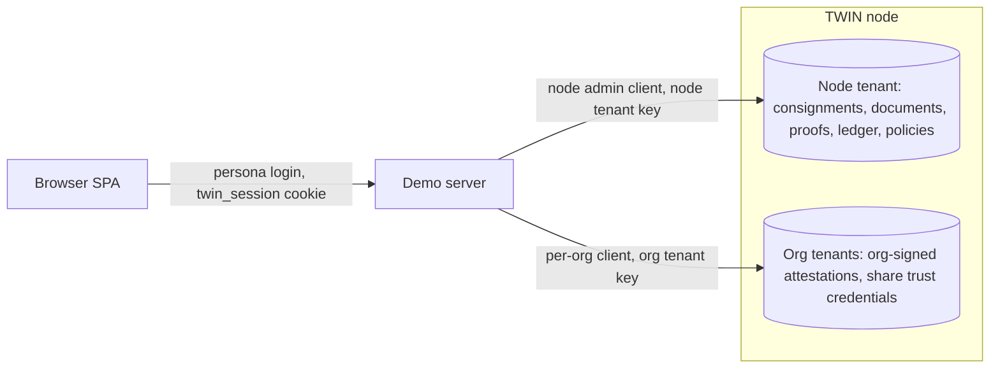

# Authentication and accounts

The demo checks persona logins against the corridor config and gates writes with a signed cookie, but it has no authorization layer: routes act on whatever org id the client sends. Behind it, each demo server calls its TWIN node (the ledger-backed service used in `docker` and `hosted` mode) with credentials held on the server, and in `docker` mode it also holds credentials for the other node. The node's own authentication model (tenant `x-api-key` plus JWT) is described in [twin-node-overview.md](twin-node-overview.md).

> **Warning: demo-grade security.** Persona passwords are `demo`, most secrets fall back to defaults written in the source, and three unauthenticated endpoints (`GET /twin/demo-session`, `/twin/demo-orgs`, `/twin/openapi.json`) hand out the node tenant API key, a fresh node JWT and TWIN passwords to anyone who can reach the demo server. Do not expose an instance to an untrusted audience without the changes listed under [Demo endpoints that hand out credentials](#demo-endpoints-that-hand-out-credentials).

## Login and session today

`POST /api/login` (`server/routes/auth.js`) finds the org whose `username` and `password` equal the request values, by plain string comparison, in this server's org list. That list is `nodes.<nodeId>.orgs` of the active corridor config, so a persona belongs to one node: Beta's importers cannot log in on Alpha. Every shipped config uses the password `demo`, and the login page's Quick Sign-In lists each org as `<username> / demo`, so persona credentials are public by design. The response returns the org without its `password` and `twinCredentials` fields.

On success the server sets the `twin_session` cookie (`server/middleware/session.js`). The value is a stateless token, `base64url(JSON {orgId, role, exp}).<HMAC-SHA256 signature>`, signed with `SESSION_SECRET`. The cookie attributes are `HttpOnly; Path=/; SameSite=Lax; Max-Age=28800` (8 hours), without `Secure`. There is no server-side session store: `POST /api/logout` clears the cookie in the browser, but a copied token stays valid until its `exp`. Setting `RATE_LIMIT_ENABLED=1` adds a limiter of 50 requests per 15 minutes on `/api/login` (`server/middleware/security.js`). It is off by default, and it keys on the client IP taken from `X-Forwarded-For` (`trust proxy` is on in `server/index.js`), so it only works behind a reverse proxy that overwrites that header. A client that reaches the server directly can send a different `X-Forwarded-For` value with each attempt.

The SPA keeps the logged-in org in React state only (`client/src/context/NodeContext.jsx`) and has no "who am I" call, so reloading the page shows the login screen again even though the cookie is still valid.

Browsers scope cookies by host, not by port, so Alpha and Beta share one `twin_session` cookie in a given browser, whether reached through the proxy on 4002 or directly on 4000 and 4001. This works because both servers use the same `SESSION_SECRET` and the token is not bound to a node. If you set `SESSION_SECRET`, use the same value on both servers. Otherwise a login on one node makes writes on the other fail with 401 in that browser. For the same reason, logging out in one tab ends the session for both nodes, and another tab keeps showing its persona until its next write returns 401.

CORS reflects any request origin and allows credentials (`cors({ origin: true, credentials: true })` in `server/middleware/security.js`). A script on any website, running in a browser that can reach the demo server (on localhost or an internal network, for example), can therefore read every open `GET` route, the credential endpoints included. A page on another origin of the same site, such as another port on the same host or a sibling subdomain of a deployment, also gets the `twin_session` cookie sent along, because `SameSite=Lax` does not separate origins of one site, so it can make logged-in writes and read the responses.

### What the session gates

`requireSession` is mounted before every router in `server/index.js` and checks only write methods:

| Request | Session required |
|---|---|
| `GET`, `HEAD`, `OPTIONS` on any path, including document downloads and the SPA | No |
| Writes to `/api/login`, `/api/logout`, `/api/public/*`, `/twin/*` | No |
| Writes to `/api/verify/*` | No. The system-to-system verify API requires an `x-service-token` header instead (`VERIFY_API_TOKENS`) |
| Any other `POST`, `PUT`, `PATCH`, `DELETE` | Yes, otherwise 401 with `"error": "Authentication required"` |

The browser WebSocket and the `/peer` channel between the two demo servers run on the same HTTP port and are not covered: neither checks any credential. Peering is described in [architecture.md](architecture.md).

### Authentication without authorization

`requireSession` stores the decoded token in `req.session`, but no route reads it. Routes take the acting org from the request instead: `creatorOrgId`, `actorOrgId` or `orgId` in write bodies, and an `orgId` query parameter on reads. Share and revoke carry no acting org id at all, only display names (`sharerOrgName`, `revokerOrgName`). The cookie therefore proves that someone logged in on a node that shares the secret, not which org is acting. In practice:

- Any logged-in user can share or revoke any consignment, rename any org (`PUT /api/orgs/:id`), change payment, letter-of-credit and contract status, and grant any org finance access, including the `owner` role (`POST /api/finance-permissions/share`).
- Any client, logged in or not, can read another org's view by changing the `orgId` parameter. `GET /api/documents` without `orgId` returns every document's metadata, and `GET /api/documents/:id/download` returns any document's file without a check.
- The few per-route rules all evaluate the client-supplied org id: only the consignment `owner` may change its status, only the finance owner may create payments, letters of credit and contracts (a role the finance share route above hands to anyone who asks), and the customs queue and the import-side customs actions require an org with the matching `customsDeskRole`.

The config `role` field is a free-text label such as `Manufacturer - Vietnam`, not a permission.

## Account layers

Three kinds of account are involved, and they are easy to conflate because all of them are called "user".

| Layer | Represents | Defined in | Credential | Used for |
|---|---|---|---|---|
| A. Demo persona | A human logging in to the SPA as an org | `nodes.<node>.orgs[]` in `configs/*.json` | `username` and plaintext `password` (`demo`) | `POST /api/login`, which only unlocks demo writes |
| B. TWIN node admin | The demo server's own identity on its TWIN node | Created in the node tenant by the anchor stage (`npm run twin:bootstrap -- --stage=anchor`) | `admin@alpha` or `admin@beta`, a password hardcoded in the repository, and the node tenant API key | All corridor data calls, the seed, REST provisioning of org users, and, from the other demo server in `docker` mode, the poll of this node's consignment graph after a cross-node share |
| C. Per-org TWIN user | A machine identity that signs as one org | Created in the org's own tenant by `npm run twin:provision-orgs` | `<orgId>@<node>.demo.local`, a random password, and the org tenant API key | Org-signed attestation NFTs, and the trust credential the org signs when it shares a consignment with the other node |

The persona password is never sent to the TWIN node. The demo server authenticates to the node with Layer B or Layer C credentials on its own, and a persona login only decides whether the browser may write to the demo server.

### Layer B: the node admin

The docker adapter (`DockerAdapter` in `server/adapter/docker.js`) talks to the node through `KitsuneClient` (`server/twin/kitsune-client.ts`), which logs in with the admin email, password and node tenant `x-api-key`, caches the JWT and logs in again shortly before it expires. The server logs in once at boot and only logs a warning if that fails. Token handling is described in [twin-node-overview.md](twin-node-overview.md#tenancy-and-authentication).

The defaults come from `server/adapter/index.js`: email `admin@<node>`, the password hardcoded in `DEMO_PASSWORD`, and the API key from `data/tenant-state.json`. `TWIN_<NODE>_EMAIL`, `TWIN_<NODE>_PASSWORD` and `TWIN_<NODE>_API_KEY` override them (`<NODE>` is `ALPHA` or `BETA`). In `docker` mode each demo server also resolves the other node's admin config the same way. A cross-node share posts a DSP activity to the recipient node's inbox, authenticated with the recipient org's tenant key and a trust credential signed by the sharing org rather than with an admin login. Node 0.9.0 rejects that call, so the data actually travels over the WebSocket peer channel. The sender then polls the recipient node's consignment graph through a client logged in as that node's admin. The inbox contract is in [dsp-design.md](dsp-design.md).

The anchor stage is the one-off step that creates each node's DIDs, its node tenant and this admin user. It creates the admin with scope `tenant-admin,user-admin` (`ADMIN_SCOPE` in `scripts/twin/wallets.mjs`). `user-admin` is what `POST /authentication/admin/users` requires, and the demo calls that route to create node-tenant org users over REST (the fallback described below). The admin's password comes from the `ADMIN_USERS` constant in `wallets.mjs`, which has no environment override, and the same value is hardcoded in several other places (see [Secrets inventory](#secrets-inventory)). To change it, either edit `ADMIN_USERS` and both `twin/<node>/bootstrap.env` files (read by `npm run twin:status`) and rebuild the nodes with `npm run twin:reseed` (reset, anchor, provisioning and seed, which spends gas again), or change it through the node API. In both cases export a matching `TWIN_<NODE>_PASSWORD` for the demo servers and the seed. [twin/README.md](../twin/README.md#admin-accounts) lists every file that must agree.

### Layer C: per-org TWIN users

`npm run twin:provision-orgs` (`scripts/twin/wallets.mjs provision-orgs`) runs after the anchor stage and before the seed. For each org in the corridor config that is not yet in `data/tenant-state.json` (every org with `--force`), it funds a new org wallet from the node wallet (`ORG_FUNDING_IOTA`, default 2 IOTA) and then, with the node CLI, creates an org DID from that wallet's mnemonic, the org's own tenant with its API key, the org DID's verification methods and `blob-encryption` vault key, and a `user`-scope account `<orgId>@<node>.demo.local` in the org tenant with a random password from `genPolicyPassword()`. The CLI is needed because only `identity-create --mnemonic` stores the mnemonic in the node vault (the node's server-side key and secret store), where minting an attestation looks for it, and the REST `POST /identity` route cannot store one. The step-by-step chain and its failure modes are in [wallet-funding-workflow.md](wallet-funding-workflow.md#org-provisioning).

`provision-orgs` defaults to `configs/vietnam-us.json`, while the server and the seed default to `configs/vietnam-us-customs.json`, so set one `CONFIG_FILE` for provisioning, seeding and the demo servers, as [running-the-demo.md](running-the-demo.md) describes. The wallet funding, the anchor chain and their on-chain cost are covered in [wallet-funding-workflow.md](wallet-funding-workflow.md).

The credentials travel through three places before the server uses them. `provision-orgs` writes `{orgDid, tenantId, tenantApiKey, address, email, password}` to `data/tenant-state.json` under `orgs.<node>.<orgId>`. `npm run twin:seed` copies the DID, email, password and API key into `data/seed-state.json`. At boot, in every adapter mode, the server fills `store.orgs[].twinCredentials` as `{email, password, tenantApiKey}` from `seed-state.json` alone, and ignores the file when its corridor differs from the loaded config. The seed skips orgs already present in `seed-state.json`, so a re-provisioned org reaches the server only after a re-seed and a server restart. `npm run twin:seed -- --only=identity --force` refreshes only the org entries, copying them from `tenant-state.json` without on-chain writes for provisioned orgs, while `--reset-state` or `--force` without `--only` also re-creates every seeded consignment and document on chain. Separately, the docker adapter reads `data/tenant-state.json` directly at runtime: the node tenant keys and, during a cross-node share, the sharing org's credentials, the recipient org's tenant key and the recipient's node. That file must therefore also be present where the demo server runs.

These org passwords are standing credentials: provisioning generates them once, nothing rotates them, and only the JWTs obtained with them expire. The org wallet mnemonics are also kept encrypted in `data/wallets.enc.json` under `orgWallets`, but minting uses the copy in the node vault.

On document upload, `server/routes/documents.js` calls `createAttestationAs` when the uploading org has TWIN credentials and the document's immutable proof (the node's signed, ledger-anchored record of the document hash) was created. The adapter lazily builds one `KitsuneClient` per org, logged in with the org's own tenant key, and mints the attestation through it. An attestation NFT is a token minted from the org's own wallet that records the org's signature over the document envelope.

An org that was not provisioned this way takes a fallback path. Registering it from the Identity page (`POST /api/orgs/:id/register`), or seeding it while it is missing from `tenant-state.json`, creates a DID through REST `POST /identity` and a user in the node tenant through `POST /authentication/admin/users`, with credentials `{email, password}` and no tenant key. Its attestation call then uses the node tenant key, and because the DID has no mnemonic in the vault the mint fails: the upload succeeds and records the error in `orgAttestationError`. Credentials created from the Identity page live only in memory, because the server never writes `data/seed-state.json`. After a restart they are gone, and registering the org again creates a new DID but leaves it without TWIN credentials, because its node-tenant user already exists (`userExists`).

## Hybrid tenant model

The nodes run with `TWIN_TENANT_ENABLED=true` (`twin/<node>/node.env`). A tenant is an isolated data partition inside one node with its own API key and users, and the node selects it from the `x-api-key` header on every request, login included (see [twin-node-overview.md](twin-node-overview.md#tenancy-and-authentication)). "Hybrid" means the demo uses two kinds of tenant at once: the shared corridor data sits in one node tenant per node, and org signatures come from one tenant per provisioned org.

| Data or operation | Tenant | Client |
|---|---|---|
| Consignments (auditable item graph), documents and their blobs, immutable proofs, the ledger stream, ODRL access policies | Node tenant | The node admin client (`store.adapter`) |
| Org-signed attestation NFTs | The org's own tenant | The per-org client (`createAttestationAs`) |
| The trust credential signed for a cross-node share | The sharing org's own tenant | The per-org client (`#mintShareTrustCredential` in `server/adapter/docker.js`) |

The rule that follows: authenticating a persona must never switch the data client to that org's tenant. The corridor data lives in the node tenant, so an org-tenant client sees an empty corridor, and reading a node-tenant proof with an org-tenant token fails with `proofNotFound`. The per-org tenant exists so that each org signs with its own DID and wallet: its attestation NFTs and the trust credential sent with a cross-node share (see [dsp-design.md](dsp-design.md)). The immutable proof of a document is issued by the node admin's organization DID, not by the uploading org. The org's own signature is the separate attestation, as described in [document-verification.md](document-verification.md).

## Demo endpoints that hand out credentials

`server/routes/twin-proxy.js` serves a Swagger page at `/twin/docs` that lets a presenter call the TWIN node's verification API without typing keys. To do that it exposes three unauthenticated `GET` endpoints:

| Endpoint | Returns |
|---|---|
| `/twin/demo-session` | The node tenant `x-api-key`, a JWT freshly minted by logging in to the node, and the email and password used for that login |
| `/twin/demo-orgs` | Every org that has TWIN credentials, with its TWIN email, password and tenant `x-api-key` |
| `/twin/openapi.json` | The node's OpenAPI spec. Its `POST /authentication/login` example is pre-filled with the same email and password as `/twin/demo-session`, and the per-org table of `/twin/demo-orgs` is appended to its description |

The login identity is the first org, in config order, whose DID and TWIN user were created over REST (registered from the Identity page, or seeded without being provisioned), because such an org is a user in the node tenant. Otherwise it is the node admin (`admin@<node>`, scope `tenant-admin,user-admin`). After `npm run twin:provision-orgs` every seeded org has its own tenant, so normally the node admin is the identity returned. `/twin/docs` calls `/twin/demo-session` on load to pre-authorize the page.

`/twin/demo-session` and `/twin/openapi.json` answer 503 in simulated mode. `/twin/demo-orgs` has no mode check: the server loads org TWIN credentials from `data/seed-state.json` at boot in every mode (see Layer C), so a simulated-mode server started next to a seeded corridor still serves the real org passwords and tenant keys.

Started with `npm run demo`, the demo servers and the routing proxy listen on all network interfaces, so anyone on the local network can call these endpoints. Because of the CORS policy described in [Login and session today](#login-and-session-today), a script on any web page opened in a browser that reaches the demo server can read them too.

In `docker` mode the TWIN node ports are published on 127.0.0.1 only (`docker-compose.twin.yml`), so from outside the host these credentials reach the node only through the `/twin/*` proxy. In `hosted` mode the node is wherever `TWIN_<NODE>_URL` points, and the handed-out credentials work against it directly if it is reachable. The proxy's allowlist covers `/authentication/(login|logout|refresh|password)`, `/immutable-proof*` and `/verifiable*`, and `/twin/*` writes need no session. That still includes `PUT /authentication/password`: anyone who can open the demo can change the node admin password and break the demo server's own node login. It also includes `POST /immutable-proof`, so anyone holding the handed-out JWT and key can create immutable proofs on the node, which are on-chain writes paid from the node wallet. Anyone with shell access to the host can use the key and admin password directly against the node. Before exposing an instance beyond a trusted audience, remove these routes or put them behind a flag and an authenticated session. The code change is tracked in [open-work.md](open-work.md).

## Secrets inventory

| Secret | Where it lives | Default and protection | Known to anyone with the code |
|---|---|---|---|
| Persona passwords | `configs/*.json`, `nodes.<node>.orgs[].password` | `demo` in every shipped config, plaintext, shown on the login page | Yes |
| `SESSION_SECRET` | Environment, read by `server/middleware/session.js` | Default `twin-demo-session-secret-change-me`. Anyone who knows the value can forge a `twin_session` cookie | Yes, unless set |
| `VERIFY_API_TOKENS` | Environment, read by `server/routes/verify-api.js` | Default `demo-customs-integration`, also printed on the public Swagger page `/api/verify/docs`. Comma-separated list of accepted `x-service-token` values | Yes, unless set |
| TWIN admin passwords (`admin@alpha`, `admin@beta`) | `twin/<node>/bootstrap.env`, `ADMIN_USERS` in `scripts/twin/wallets.mjs`, `DEMO_PASSWORD` in `server/adapter/index.js` (overridden by `TWIN_<NODE>_PASSWORD`), `twin/README.md`, the tests. `scripts/twin/up.sh` prints them | The same plaintext value in every file | Yes, unless changed |
| Node tenant API keys | `data/tenant-state.json` `nodes.<node>.tenantApiKey`, or `TWIN_<NODE>_API_KEY` | Plaintext, file mode 0600 | No, generated by the anchor |
| Org tenant API keys and org TWIN passwords | `data/tenant-state.json` `orgs.<node>.<orgId>` (mode 0600), copied into `data/seed-state.json` (default file mode) | Plaintext, no rotation | No, generated by `provision-orgs` |
| Node and org wallet mnemonics | `data/wallets.enc.json` | AES-256-GCM, key derived from `WALLET_PASSPHRASE` | No. Each operator creates it locally with `npm run twin:wallets:create`, and `.gitignore` excludes `data/`. Reading it needs the passphrase |
| Node vault: wallet mnemonics, DID signing keys, the `auth-signing` key that signs node JWTs, `blob-encryption` keys | Each node's MySQL database in its Docker volume (`TWIN_VAULT_CONNECTOR=entity-storage` in `twin/<node>/node.env`) | Database access only (next row). A copy of the database is a copy of every key | No |
| `WALLET_PASSPHRASE` | Shell environment (for example a `.env` file sourced into each terminal, since the scripts do not read it themselves) or a CI secret | No default, required by the wallet scripts | No |
| Node database passwords | `TWIN_MYSQL_ROOT_PASSWORD` and `TWIN_MYSQL_PASSWORD`, substituted into `docker-compose.twin.yml` from the environment or the root `.env` (the compose file overrides `TWIN_MY_SQL_PASSWORD` from `twin/<node>/node.env`) | Defaults `root` and `twin` | Yes, unless set |

Three points matter beyond a laptop:

- `docker-compose.deploy.yml` passes neither `SESSION_SECRET` nor `VERIFY_API_TOKENS`, so a deployment built from it runs with the code defaults unless you add them. Deployment is covered in [deployment.md](deployment.md).
- In `docker` mode each demo server holds the other node's admin credentials and node tenant key (see Layer B), and both read the whole `data/tenant-state.json`, which holds every org's tenant key and password on both nodes. Access to one demo server host therefore gives admin access to both nodes and lets the holder act as any org.
- Copying or zipping a working directory after setup also copies `.env`, `data/tenant-state.json`, `data/seed-state.json` and the wallet bundle `data/wallets.enc.json`. Remove them before handing the directory to anyone else.

The threat model of the encrypted wallet bundle and the rotation procedure are in [wallet-funding-workflow.md](wallet-funding-workflow.md).
