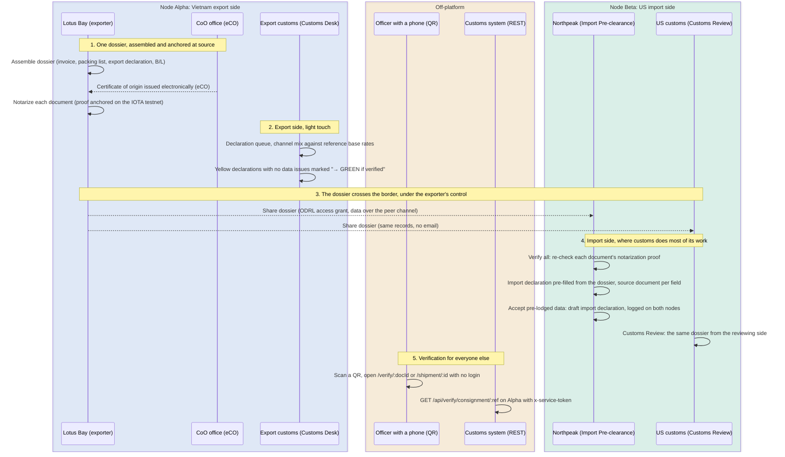
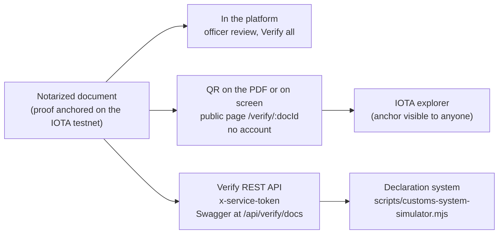

# Customs demo: story and functional flow

> All organisations, people, addresses, documents and figures in the shipped corridor configs are fictitious, and any resemblance to real companies or authorities is coincidental. Countries, ports, laws and trade agreements are real, and their mention implies no involvement or endorsement by the governments or organisations concerned.

This document explains what the customs demo argues, who appears in it and what to say about its limits. It is meant for whoever presents the demo to customs authorities or to the organisations around them (certificate-of-origin authorities, brokers, digital-customs programmes), and for engineers who extend the customs views. The click-by-click script is the [customs section of DEMO_GUIDE.md](../DEMO_GUIDE.md#customs-demo-one-dossier-two-declarations). The same guide's [Before you present](../DEMO_GUIDE.md#before-you-present) section covers starting the demo and how docker and simulated mode change what the audience sees.

The demo runs on `configs/vietnam-us-customs.json`, the default corridor: garments (HS chapters 61 and 62) exported from Vietnam to the United States, with one shipment to the Netherlands. It is the only shipped config whose organisations have a `customsDeskRole`, so it is the only one with the customs views.

## The story

> Export and import declarations are prepared from the same documents. With TWIN, each document carries a proof of integrity that anyone can check, and the exporter decides through an access policy who receives it. Today the same documents arrive as email attachments that nobody can verify.

TWIN is the node software each side runs: it issues identities, notarizes documents, stores access policies and anchors its proofs on the IOTA network ([twin-node-overview.md](twin-node-overview.md)). In this demo the documents cross between the two sides over a peer channel between the two demo servers, and TWIN provides the proofs and the access policy.

When a Vietnamese consignment reaches its destination, the supporting documents behind the import declaration arrive as emailed PDF scans. Destination officers have no practical way to check a Vietnamese electronic certificate of origin or export release, so authenticity is taken on trust and every value is typed again into the import declaration. Customs risk engines route each declaration to a channel: green (released on the data), yellow (document review) or red (physical inspection). A yellow declaration waits one to three working days (the reference figure the demo displays) while officers review PDFs that another authority already checked at export. Every beat contrasts with this picture. The demo does not argue that a national system is wrong. It argues that the carrier between systems (email) is the weak link, and proposes to replace only that.

## Four premises

These are the working assumptions behind the story. Check them for each target corridor.

1. **One dossier, two declarations.** The exporter files the export declaration and the importer files the import declaration, and both are prepared from the same commercial dossier: invoice, packing list, certificate of origin, transport document. Today that dossier crosses the border without provenance.
2. **Customs' core business is imports.** Duties, VAT and most prohibited and restricted goods controls apply on import, while export control is light (statistics and restricted-goods screening). The strongest beat is therefore on the import side: a declaration pre-filled from a verified dossier.
3. **There is no routine authority-to-authority channel for supporting documents.** Customs mutual-assistance agreements, where they exist, allow case-by-case requests, but the Vietnamese and US customs authorities do not routinely exchange the documents behind each declaration. The realistic flow is the exporter provisioning the importer, with both authorities able to verify. The demo does not pretend otherwise.
4. **Verification must work without membership.** An officer in the destination country will not open an account on a Vietnamese platform to check a document. Verification has to work from a printed page with no account, or from a REST call with a service token, with no user enrolment.

## The cast

All passwords are `demo`. The complete login table, including the organisations that play no part in this story, is in [DEMO_GUIDE.md](../DEMO_GUIDE.md#logins).

| Persona | Login | Node | Role in the story |
|---|---|---|---|
| Lotus Bay Apparel JSC | `lotusbay` | Alpha | The exporter. Owns the dossier and decides who receives it. |
| Hanbit Fibers Co., Ltd | `hanbit` | Alpha | Input supplier in South Korea. Stands for the supplier evidence behind the exporter's origin claim. No beat logs in as Hanbit Fibers. |
| Certificate of Origin Office (Vietnam) | `vncoo` | Alpha | Issues the certificate of origin through its electronic certificate-of-origin system. The seeded certificates carry its name. No beat logs in as the certificate of origin office. |
| Export Customs Office (Vietnam) | `vncustoms` | Alpha | Export-side officer. Sees the **Customs Desk**: a declaration queue in the style of a national customs system, with channel simulation. |
| Northpeak Athletics Inc. | `northpeak` | Beta | Importer or its broker. Sees **Import Pre-clearance**: the import declaration pre-filled from the verified dossier. |
| Import Customs Office (United States) | `uscustoms` | Beta | Destination officer. Sees **Customs Review**: the same dossier from the reviewing side. |
| Anyone with a phone | none | none | Scans a QR code and lands on a public verification page with no account. |
| A customs IT system | service token | none | Calls the verify REST API with the `x-service-token` header (default `demo-customs-integration`). `VERIFY_API_TOKENS` replaces the default with a comma-separated list, and the simulator then needs `--token`. `scripts/customs-system-simulator.mjs` plays this system. |

The seed data uses formats a customs officer knows: one exporter and six export declarations in the style of a national customs system, with 12-digit numbers, declaration type B11 (an ordinary commercial export), the registering customs office, the trader's tax code and container, seal and bill of lading references that match between the declaration and the generated XML documents. The seeded "Container Loaded" entries in the activity log use separately generated `TCKU` container and `SL` seal numbers, so point the audience at the Customs Desk and the XML documents for these references. The six declarations play different parts:

| Consignment | Channel | Part in the story |
|---|---|---|
| `VN-2026-EXP-00101` | green, release pending | The hero: 24,000 men's cotton polo shirts, USD 168,000 FOB, the port of Ho Chi Minh City to the Port of Los Angeles, dossier verified. It is the consignment that crosses the border. |
| `VN-2026-EXP-00102` | green, released | A routine shipment that already cleared. |
| `VN-2026-EXP-E001` | yellow | The HS code on the export declaration differs from the invoice: a data error. |
| `VN-2026-EXP-00103` | green, released | Bound for the Netherlands, with an EUR.1 certificate that must still travel on paper. |
| `VN-2026-EXP-00104` | yellow | Same exporter, but its documents arrived the old way, as emailed PDFs. |
| `VN-2026-EXP-00107` | red | Declared Vietnamese origin, but 34% of the value has no input certificate of origin. |

The declaration dates are fixed in the config (the hero is dated 12 June 2026), so do not present the hero as "declared today". The seed data also carries US-side details for each US-bound consignment (a US customs entry number, a 10-digit HTS code, a duty rate of 19.7% for the hero and a flag for the Uyghur Forced Labor Prevention Act, UFLPA). Of these, the UI shows only the HTS code (in the pre-filled import declaration and on the public shipment page), and UFLPA appears only as a smart-contract release condition on the Trade Finance page. The container numbers pass the ISO 6346 check digit, under the fictitious owner code `BWLU`.

## Functional flow

Steps 1 and 2 are in the seed data (the anchoring in step 1 exists only in docker mode, after `twin:seed`). Steps 3 to 5 happen live during the demo.

In step 3 the access grant is recorded on a TWIN node only in docker mode, where the share creates an ODRL policy on Alpha's node (ODRL is the W3C policy language TWIN uses for machine-readable access rules). In simulated mode the grant exists only in the demo server's memory. In both modes the consignment and its files travel over the WebSocket peer channel between the two demo servers. In docker mode the demo also attempts a delivery over the Dataspace Protocol (DSP, the Eclipse standard for exchange between data-space connectors), which TWIN node 0.9.0 rejects. [dsp-design.md](dsp-design.md) has the details.

In step 4 either Beta role can run **Verify all** and accept the pre-lodged data. The click script has `northpeak` do both.

The same notarized document can be verified in three places, which is the demo's answer to verification without membership:

What each path actually checks, and how a document anchored on the other node is verified, is described in [document-verification.md](document-verification.md).

## Beat arc

The beats match the customs script in [DEMO_GUIDE.md](../DEMO_GUIDE.md#customs-demo-one-dossier-two-declarations), which budgets 15-20 minutes for all eight.

| Beat | The audience need it answers | What it shows |
|---|---|---|
| 0. The "before" | Name the problem in their terms | Nothing on screen: supporting documents arrive as emailed scans |
| 1. The officer's queue | About 30% of declarations are channelled yellow (the reference base rate) and wait days on manual document review | Verified documents give a risk engine what it needs to keep more declarations green. The channel decision stays with the authority, and the demo never calls a past decision wrong |
| 2. What provenance cannot fix | The hardest origin fraud is a genuine certificate with false content, so enforcement needs the evidence behind the certificate | `VN-2026-EXP-00107` stays red even though its documents are anchored. `VN-2026-EXP-E001` shows a data inconsistency that shared, verified data surfaces earlier |
| 3. The paper rule | Officers distrust claims of legal equivalence | Above EUR 6,000 the printed EUR.1 is still the legal instrument and the digital copy is evidence |
| 4. One dossier crosses the border | Import is where customs does most of its work and where re-keying costs time | The import declaration is pre-filled from the shared dossier, each field naming its source document, and only the importer's own fields remain |
| 5. Verification without an account | Officers outside the issuing country cannot verify its documents and will not enrol on a foreign platform | A QR on the PDF opens a public page. A tampered file fails the fingerprint check |
| 6. System to system | Authorities integrate through their own systems, not through a new screen | A simulated declaration system pulls verification over REST and gets a channel recommendation that names the authority as the decision owner |
| 7. The driver at the checkpoint | The same need at shipment scope: an officer at a checkpoint needs the whole dossier of one truck | One QR on a transport pass opens the shipment's dossier with each document's verification state, and nothing about payments or other loads |

The closing line ties the beats together: the same dossier serves both declarations, and each document can be verified by anyone the exporter shares it with, down to a driver showing one code at a checkpoint, while the alternative in use today is email.

## What the demo does not do

Say these before the audience asks.

By design:

- **It does not replace any national customs or certificate-of-origin system.** It is a verified-data layer that feeds them, and [Beat 6](../DEMO_GUIDE.md#beat-6-system-to-system) shows that surface.
- **It does not decide channelling.** The channel recommendation is a transparent fixed rule (verified dossier, no data error and complete origin evidence means green), and the simulator output names the authority as the decision owner.
- **It does not claim legal equivalence.** EUR.1 above EUR 6,000 stays a paper instrument, and the digital document is an evidence copy, not the legal original.
- **It does not fix false content with cryptography.** A notarization proof shows that the document is unchanged since it was registered on the node, and when. It does not show that its content is true. This is why the origin evidence chain matters and why `VN-2026-EXP-00107` stays red.
- **It does not create an authority-to-authority channel.** The exporter controls sharing, and each authority verifies independently.
- **Public visibility is a feature of the demo server, not of the TWIN node.** The public `/verify/:docId` and `/shipment/:id` pages, and the per-document-type `publicAccess` setting (`content`, `verify` or `none`, defaulting to `verify`) that decides what the shipment page lists and lets the viewer open, are implemented in this repository. The shipment link is a permanent bearer link, and for seeded consignments it can be guessed from the UCR. A production version would replace it with a signed, time-limited and revocable access grant. See [document-verification.md](document-verification.md).

Demo shortcuts to disclose if asked:

- The base rates (66%, 30.3%, 3.4%) and clear times are hard-coded. The code labels the rates as published H1 2024 channelling rates, a source not re-checked for this document. None of this is a risk engine.
- Cross-border delivery uses the peer channel between the two demo servers, not a Dataspace Protocol transfer (see the functional flow above).
- On the receiving node, **Verify all** first asks the local TWIN node to verify the proof. If that fails, it falls back to confirming that the anchor object exists on the IOTA testnet, which does not compare it with the document's hash.
- In docker mode the seed notarizes the documents of every consignment, including `VN-2026-EXP-00104`, so its dossier reads as verified and only its yellow channel and **→ GREEN if verified** badge show the emailed-PDF case. In simulated mode it reads "Unverified (emailed PDFs)", but the verification beats show demo-mode states. [DEMO_GUIDE.md](../DEMO_GUIDE.md#before-you-present) has the full comparison.
- The customs view hard-codes Vietnam-specific labels (the MST tax code, "0% (garments)" export duty), while organisations and data come from the config. Reusing the view for another corridor means replacing those labels in `client/src/components/CustomsDesk.jsx`.

[open-work.md](open-work.md) tracks these gaps with next steps.

## Questions to ask the audience

The demo is also a way to learn what a customs audience needs. Listen for answers to these:

1. Where does origin enforcement sit at export, with customs or with the certificate-of-origin authority? If it sits with the authority, present the origin-composition view as its tool, with customs as the verifier.
2. Which document types would officers most want verified first?
3. Would they rather receive verified data inside their own systems, or pull it from an API as in Beat 6?
4. Are there data-residency constraints on where a node for a pilot could run?
5. Is there interest in the reverse flow, verified supporting documents for imports into Vietnam (Beat 4 with Vietnam as the destination)?
