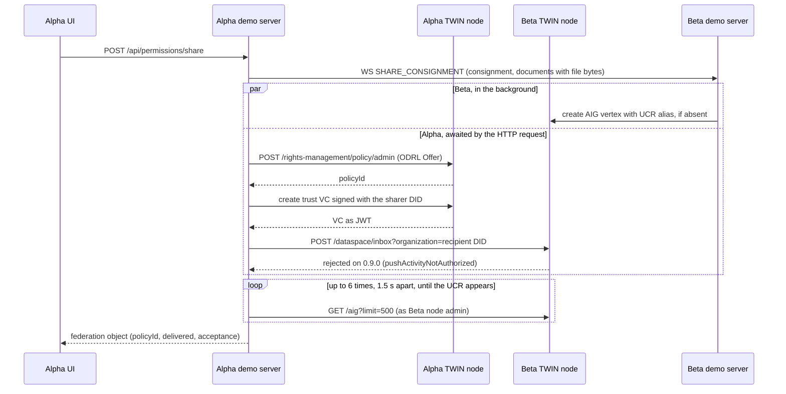

# DSP federation on TWIN node 0.9.0

On node 0.9.0 a cross-node share does three things. It creates a real ODRL access policy on the sharer's node. It tries to deliver the consignment to the recipient's node through the DSP inbox, which the node rejects because the demo never sets up a DSP transfer. And it sends the consignment, including the document files, over the demo's WebSocket peer channel, which is what actually delivers it. The recipient's demo server then writes the consignment as a vertex on its own node's AIG, and the sharer confirms the share by reading that AIG. The UI labels the result a Dataspace Protocol delivery, which overstates what happened (see [What the UI shows](#what-the-ui-shows)).

This happens in `docker` and `hosted` mode. In `simulated` mode none of it runs and the peer channel is the only cross-node path. Components, ports and WebSocket message types are in [architecture.md](architecture.md), and the node modules and the extension mechanism are in [twin-node-overview.md](twin-node-overview.md). Cross-node proof verification is not a DSP exchange even though the API labels one of its sources `dsp` (see [document-verification.md](document-verification.md)). Several code comments still describe superseded DSP behaviour. Where they disagree with this document, the behaviour described here is what runs (see [Known defects](#known-defects)).

| Term | Meaning here |
|---|---|
| DSP | Eclipse Dataspace Protocol, a standard for data exchange between independent connectors: a catalogue of datasets, a contract negotiation that ends in an agreement, and a transfer process that moves the data. The TWIN node implements it. The demo calls the inbox, plus a boot-time catalogue query that returns nothing (see [Share flow](#share-flow)). |
| ODRL | W3C policy language for permissions. The node stores ODRL policies in its policy administration point (PAP) under `/rights-management/policy/admin`. |
| Activity | A W3C Activity Streams message (`Add`, `Remove`) posted to a node's DSP inbox. The node hands it to a dataspace app chosen by the type of the activity's `object`. |
| Dataspace app | A component that a node extension registers with the TWIN node. It declares the activity object types it handles (`activitiesHandled()`) and the datasets it offers (`datasetsHandled()`), and the node routes each accepted inbox activity to the app whose types match. This repo's app is the corridor DataspaceApp in `twin/dataspace-app.mjs`. |
| AIG | Auditable item graph, the node module where the demo stores consignments as vertices (`GET /aig`). Each consignment vertex carries its UCR (unique consignment reference) as an alias. |
| Ledger entry | An entry in the demo server's activity log (`addLog` in `server/store.js`), shown on the Analytics page and also written to the node's auditable item stream in `docker` and `hosted` mode. |
| Trust VC | A verifiable credential, issued as a JWT signed with an organisation's DID key, that the receiving node verifies to identify the sharer. |
| Tenant | Each node is multi-tenant and a request picks its tenant with the `x-api-key` header. The node admin (`TWIN_<NODE>_EMAIL`, `TWIN_<NODE>_PASSWORD`) logs in with the node's tenant key (`TWIN_<NODE>_API_KEY`, or `nodes.<node>.tenantApiKey` in `data/tenant-state.json`). After `npm run twin:provision-orgs` every organisation also has its own tenant and tenant user (see [authentication-architecture.md](authentication-architecture.md)). |

## Share flow

A cross-node share depends on two pieces of state. First, the share route takes the DSP path only for a recipient listed in `store.peerOrgs`. That list is filled over the peer channel (`HANDSHAKE` on the accepting side, the `ORG_DIRECTORY` reply on the side that clicked Connect, later `ORG_UPDATE`) and emptied when the channel closes. The federated catalogue that could also fill it yields nothing: nothing registers datasets, and on 0.9.0 the boot-time `POST /federated-catalogue/request` has been seen to fail before reaching the catalogue, with a `CredentialStructure` error, because it sends the session JWT where the node expects a trust credential ([details](open-work.md#the-federated-catalogue-is-empty-and-peer-discovery-depends-on-the-websocket-handshake)). Boot hydration then finds no peers. A cross-node share therefore needs the peer channel connected through the Connect action. While the peer is offline the share dialog shows "Peer node offline — cross-node sharing unavailable.", and the peer organisations drop out of the list once it reloads. An entry still listed from before the disconnect stays clickable, and sharing with it records only a local grant. Second, `data/tenant-state.json` must list the recipient under `orgs.<node>.<orgId>`, which `npm run twin:provision-orgs` writes. Without that entry `resolveOrgNode` finds nothing, the activity goes to the sharer's own node, no observation runs and the receipt shows the delivery as failed.

`POST /api/permissions/share` (`server/routes/permissions.js`) then:

1. Records the grant in memory (`store.permissions`, plus per-document grants for a selective share) and stores an ODRL preview that only the API returns (`odrlPolicy` in the share response and `GET /api/permissions/:consignmentId/odrl`). The preview (`odrl:Set`, action `odrl:read`) is never sent to the node, and the UI does not show it.
2. Sends `SHARE_CONSIGNMENT` over the peer channel with the consignment, the shared documents including their file bytes (`fileBase64`), and the permission maps.
3. Calls `dspShareConsignment` (`server/adapter/docker.js`) and waits for it, so that the HTTP response can carry the `federation` object the UI renders. This call creates the ODRL policy on the sharer's node, builds an `Add` activity (`buildShareActivity` in `server/adapter/dsp.js`), finds the recipient's node with `resolveOrgNode`, mints a trust VC for the sharer organisation, posts the activity to the recipient node's inbox as described in [the inbox contract](#the-090-inbox-contract), and finally observes the recipient's AIG to confirm receipt. On 0.9.0 the inbox POST fails, `forwardActivity` throws, and the adapter logs a warning and moves on to the observation.

On the recipient, the `SHARE_CONSIGNMENT` handler in `server/ws.js` adds the consignment, documents and permissions to memory. If the consignment is new to that demo server, `replicateConsignmentToNode` starts in the background: it checks that no vertex with that UCR exists, writes the consignment as a vertex on the recipient's own AIG through the recipient's node admin client, with the alias `{ id: <UCR>, aliasFormat: 'urn:moit:ucr' }`, and logs a "Consignment Received" ledger entry once the write succeeds. The handler also raises a notification and broadcasts `DATA_SYNC` to the browsers. Separately, `pollInboundShares` runs every 5 s in `docker` and `hosted` mode, lists the consignment vertices on the local node and adds any that are not in memory yet. In normal operation the WebSocket handler got there first, so the poll only changes anything after a recipient restart or a revoke (see [Restarts](#restarts) and [Revoke and document upload](#revoke-and-document-upload)).

### The ODRL policy

`buildOdrlOfferPolicy` (`server/adapter/dsp.js`) builds an ODRL `Offer` and `createOdrlPolicy` (`server/twin/kitsune-client.ts`) stores it on the sharer's node.

| Field | Value |
|---|---|
| `uid` | `policy:<ns>:<consignmentId>:<recipientOrgId>`. `<ns>` is `corridor.urnNamespace` from the corridor config, default `corridor`. No shipped config sets it. |
| `assigner` (top level) | Sharer organisation DID |
| `permission` | Two entries per target, actions `use` and `modify`, each with `assignee` = recipient organisation DID and the constraint `purpose eq supply-chain-collaboration`. `modify` is there so the recipient can add documents back. |
| Targets | `urn:<ns>:consignment:<id>` for a full share, one `urn:<ns>:document:<docId>` per selected document for a selective share |
| `@context` | `http://www.w3.org/ns/odrl.jsonld` |

An organisation without a DID is written as `urn:<ns>:org:<orgId>`. The node rejects the policy (500 `namespaceMismatch` or 400 `common.validation`) when the uid does not start with `policy:`, when `@context` uses `https://`, or when an Offer lacks a top-level `assigner`. The policy is a real record in the sharer node's PAP, and revoke deletes it. Nothing in this repo anchors it on chain, although the receipt calls it "anchored". Nothing reads it back at request time either: the demo server's access checks use the in-memory permission map.

## The 0.9.0 inbox contract

This contract was found by probing a running 0.9.0 node, not from the node's documentation. The OpenAPI spec published with 0.9.0 does not match the running node for this route, so do not rely on it.

| Requirement | Observed result without it | What the demo sends (share only) |
|---|---|---|
| Route `POST /dataspace/inbox` on the recipient's node | The spec's `/dataspace-data-plane/inbox` returns 404 | `<recipient node URL>/dataspace/inbox` |
| Query parameter `?organization=<recipient org DID>` | 401 `TenantProcessor.missingOrganizationId` | The recipient organisation's DID |
| Header `x-api-key` for the recipient tenant | Not observed in isolation | The recipient organisation's tenant key (`orgs.<node>.<orgId>.tenantApiKey` in `data/tenant-state.json`). An organisation that is not listed there is never routed to the other node, so the POST goes to the sharer's own node with that node's tenant key (see [Share flow](#share-flow)). |
| `Authorization: Bearer <trust VC JWT>` | 401 `TrustHelper.trustVerifyFailed` | A VC minted for the sharer organisation (see [Trust and credentials](#trust-and-credentials)) |
| A DSP transfer process between the two parties in state `STARTED` | `pushActivityNotAuthorized` | Nothing. The demo never negotiates a contract or starts a transfer. |

The last row is the blocker. In DSP a provider pushes data only inside a transfer process, and a transfer starts only after a contract negotiation has produced an agreement. On 0.9.0 the node enforces this on its inbox (`DataspaceDataPlaneService.notifyActivity`). The demo implements none of that lifecycle, and the code does not check for this state: `forwardActivity` treats any 2xx as delivered.

The activity itself must also have the right shape. These rules are encoded in `buildShareActivity` and come from probing a node build older than 0.9.0. They have not been re-verified on 0.9.0, because no activity gets past the transfer check.

- `generator` must be a DID, otherwise the inbox returns 400 `invalidActivityGeneratorIdentity`. The demo uses the sharer organisation's DID.
- The node routes an activity by the expanded type of its `object`, so the object is the consignment itself, expressed in the UN/CEFACT vocabulary (release D23B, `https://vocabulary.uncefact.org`) with `type: "Consignment"` and built by `consignmentToUnece` in `server/twin/unece.js`, with document metadata under `attachment`. An Activity Streams `Document` wrapper is accepted with 201 but reaches no app.
- File bytes never ride the activity: `buildShareActivity` strips `fileBase64` from every document.

Code comments still describe several things that node 0.9.0 does not have: the `/dataspace/notify` route, the node's `tenant-token` CLI and the `?x-enc-tenant-token=` query gate it fed, the `TWIN_DATASPACE_PEER_NODES` setting (peers are addressed per request), and the `TWIN_RIGHTS_MANAGEMENT_ENABLED` toggle (rights management is on whenever `TWIN_DATASPACE_ENABLED=true`). The encrypted tenant token is still plumbed through the code (`resolveTenantToken` in `server/adapter/index.js`, env `TWIN_<NODE>_ENC_TENANT_TOKEN`, the `encTenantToken` client option) but no request sends it, and `scripts/twin/wallets.mjs` still tries the removed CLI during the anchor stage and logs a harmless failure.

## How the sharer confirms receipt

What runs on 0.9.0 is an observation of the recipient's AIG. When there is no acceptance and the recipient sits on the other node, `dspShareConsignment` polls the recipient node's `GET /aig?limit=500` through the peer client, logged in as the recipient node's admin, up to 6 times, 1.5 s apart, looking for a vertex whose UCR alias matches. A match sets `delivered: true` and `acceptance: { accepted: true, ucr, node, acceptedAt, vertexId, observed: true }`. The vertex it finds is the one the recipient demo server wrote after the WebSocket message, or one left by an earlier share of the same UCR, since vertices persist across restarts. The observation therefore proves that the recipient node holds the consignment, not that DSP delivered it. Because the HTTP response waits for this loop, a cross-node share takes at least 9 seconds when the vertex does not show up. The loop reads a single page of up to 500 vertices, with no sort order and no cursor, so on a node holding more vertices the match can fall outside that page. Whether it does depends on the node's default order, which was not checked.

If the inbox ever accepts the POST, `forwardActivity` first looks for the dataspace app's acceptance in the response. In the 0.9.0 models (`IActivityLogEntry` in `@twin.org/dataspace-models`), the node records each inbox activity as an activity-log entry whose tasks each belong to one dataspace app (`dataspaceAppId`), and a task carries the app's return value in `result` once it completes. The code assumes, from the 0.9.0 OpenAPI spec, that the inbox processes activities asynchronously. When the immediate response has no result, it polls `GET /dataspace-data-plane/activity-logs/{id}` without credentials up to 6 times, 1.2 s apart, and stops early if a task reports an error. This path has never completed against a 0.9.0 node because the POST fails, so the response shape, the activity-log route and the unauthenticated poll are all unconfirmed.

## What the UI shows

When `POST /api/permissions/share` returns a non-null `federation` object, the share dialog shows `FederationReceipt.jsx`. The object carries `policyId`, `activityLogId`, `federatedToNode`, `delivered`, `accepted`, `acceptance`, `permitted` (`use`, `modify`), `documentCount`, `sharer` and `recipient`, or only `error` when `dspShareConsignment` threw (for example because the policy could not be created).

| # | Receipt step | Shown as done when | Text when done |
|---|---|---|---|
| 1 | Access granted | `policyId` is present | "A verifiable permission was anchored: {sharer} grants {recipient} use + modify on this consignment." |
| 2 | Delivered over the data space | `delivered` | "Pushed the consignment + {n} documents to {recipient}'s node through the Dataspace Protocol (DSP)." |
| 3 | Received on {recipient node} | `accepted` or `delivered` | With `accepted`: "{recipient}'s node ingested the consignment into its own ledger (AIG) over the Dataspace Protocol", plus the vertex id |

On 0.9.0 both `delivered` and `accepted` come from the AIG observation, so steps 2 and 3 report a DSP delivery and ingestion that did not happen. Step 1 says the permission was "anchored", although the policy is only stored on the node, and the footer calls the share "a real protocol exchange between two independent nodes", "not a copy". The response already carries `acceptance.observed`, so the receipt could tell the cases apart. If the observation finds nothing, step 2 shows "The Dataspace Protocol transfer did not complete" and step 3 says the recipient has not confirmed receipt, even when the WebSocket delivery worked and the recipient's AIG write was only slow.

On the sharer, every share that returns a `federation` object without `error` also adds a "Federated → {Node}" pill to the consignment row and detail header, even when steps 2 and 3 failed. Its tooltip says the consignment was federated over the Dataspace Protocol and delivered to the recipient's "sovereign node". The pill is held only in client state (`federatedMap` in `Consignments.jsx`), so a page reload clears it. The Permissions page makes a similar claim: it describes sharing as "encrypted in transit and at rest" and "granted by a verifiable ODRL policy over the Dataspace Protocol", while the data crosses nodes over the `/peer` WebSocket, which has no authentication and uses plain `ws://` in the shipped configuration.

On the recipient, a share raises a toast ("Consignment shared with you") and an entry in the header bell (`NotificationBell.jsx`) that reads "Node Alpha shared this consignment over the Dataspace Protocol", which overstates the transport in the same way. Notifications are held in memory per demo server, not per organisation, so every user on the recipient server sees the entry whichever organisation received the share, and acknowledging it clears it for everyone. The notification endpoints and WebSocket messages are described in [architecture.md](architecture.md). The consignment list shows a "Shared from {node}" pill whenever a consignment's `originNode` differs from the local node.

## Revoke and document upload

`POST /api/permissions/revoke` starts `dspRevokeConsignment` in the background and responds without waiting for it. On 0.9.0 the revoke has these effects:

| Effect | Result |
|---|---|
| In-memory grants on the sharer | Removed |
| `REVOKE_CONSIGNMENT` over the peer channel | The recipient drops the consignment, its documents and permissions from memory |
| Node ODRL policy delete (`dspRevokeConsignment`) | Takes effect when the policy id saved at share time (`twinPolicyId`) is still in memory. A sharer restart loses it (see [Restarts](#restarts)). |
| `Remove` activity | Posted to the sharer's own node with only that node's tenant key, without `?organization=` or a trust VC, so it fails and the failure is only logged. The corridor DataspaceApp would acknowledge `Remove` without acting on it anyway. |
| Replicated vertex on the recipient's AIG | Stays, because the AIG has no delete (a vertex can only be updated, with each change kept as a changeset) and nothing writes a revoked flag. From reading the code (not confirmed on running nodes), the recipient poll then finds the vertex missing from memory and re-adds it within 5 s, with a new "received ... via the Dataspace Protocol" ledger entry and, if the earlier notification was acknowledged, a new bell entry. |

The re-added consignment stays hidden from the recipient's organisations because their grant is gone.

A document added to a shared consignment (`POST /api/documents`, `server/routes/documents.js`) is anchored on the writer's node and then mirrored by `mirrorDocumentToPeer` (`server/store.js`), which sends `UPLOAD_DOCUMENT` with the file bytes over the peer channel whenever the consignment's permission map includes an organisation from the other node. That holds on both sides: the owner's map lists the recipient organisation, and the map the recipient received with the share lists the owner organisation. When the writer is the recipient, writing back to a consignment that came from the other node, `dspNotifyDocumentUpload` also posts an `Add` activity in the background, but to the writer's own node, without the inbox credentials and with an Activity Streams `Document` object that the corridor DataspaceApp does not handle. Only the WebSocket copy arrives.

## The corridor DataspaceApp

`twin/dataspace-app.mjs` is a node extension: both TWIN node containers load it through `TWIN_EXTENSIONS=/app/dataspace-app.mjs` from a read-only bind mount in `docker-compose.twin.yml`, so the node image is not forked (the extension mechanism is described in [twin-node-overview.md](twin-node-overview.md)). It registers the component `corridorDataspaceApp` as a dataspace app. Because no activity reaches the inbox on 0.9.0, it is loaded but not exercised by today's demo flow.

| Hook | Behaviour |
|---|---|
| `activitiesHandled()` | The UNECE `Consignment` and `Document` IRIs (`https://vocabulary.uncefact.org/Consignment`, `.../Document`) |
| `handleActivity()`, any type except `Remove` | Finds or writes an AIG vertex for the consignment through the in-process AIG component (looked up by UCR alias, written with alias format `urn:moit:ucr`) and returns an acceptance (`accepted`, `ucr`, `vertexId`, `documentCount`, `acceptedAt` and the node id). Returns `accepted: false` with `reason: 'no-consignment'` when the activity carries no UCR. |
| `handleActivity()`, `Remove` | Returns `accepted: true` and does nothing else |
| `datasetsHandled()` | One static dataset with an ODRL Offer permitting `read`. The federated catalogue is still empty, and the demo never registers datasets through the node's API. |
| `handleDataRequest()` | Returns empty data |

If the AIG component did not resolve when the app started, `handleActivity()` returns `accepted: false, reason: 'aig-unavailable'` for every activity, `Remove` included.

The app logs through the node logger at info level: `started, node=<id>, aig=<component or UNRESOLVED>` at start, then `inbound activity: ...` and `ingested consignment ucr=<UCR> -> AIG vertex <id>` for each activity it ingests. Once activities reach the inbox, check for these lines in the node container logs (`npm run twin:logs` follows Alpha, `npm run twin:logs -- beta` follows Beta).

Two identifiers are fixed in the code. `CorridorDataspaceApp.APP_ID` is a URL on a domain of the original developers, used only as an identifier and never fetched. A fork that runs its own nodes should set one it controls. The alias format `urn:moit:ucr` is the same in every corridor (`moit` is a fixed prefix that no setting changes). It is written for replicated and seeded consignments (`twin/dataspace-app.mjs`, `server/ws.js`, `scripts/seed-twin-nodes.js`), while consignments created in the UI use `ucr`. Every lookup in the demo server matches any alias format containing `ucr`, and the app looks up by alias id alone, so the value only matters to someone reading the AIG directly.

## Trust and credentials

Both nodes set `TWIN_TRUST_VERIFIERS=jwt-verifiable-credential` (`twin/alpha/node.env`, `twin/beta/node.env`), which makes the inbox verify the bearer credential by resolving the signer's DID on the IOTA network. `#mintShareTrustCredential` in `server/adapter/docker.js` issues it with subject `{ id: <sharer DID>, '@type': 'OrganizationTrustAssertion', organization }` and id `urn:<ns>:trust:<sharerOrgId>:<recipientOrgId>`, signed with the sharer DID's `#org-assertion` verification method. It logs in as the sharer organisation's own tenant user when `data/tenant-state.json` has one, and otherwise falls back to the node admin. If minting fails, the inbox POST goes out without a bearer and gets the 401. The VC is sent on every share, although a comment above the method calls it "not currently wired".

The trust VC proves who signed it, nothing more. No trust registry or allow-list checks the verified DID against a set of partner organisations, and the `/peer` channel, which carries the actual data, has no authentication.

The demo also takes a credential shortcut that two independent parties could not. `resolvePeers` (`server/adapter/index.js`) gives each `docker`-mode demo server the other node's URL, admin login and tenant key. These come from `TWIN_<NODE>_URL`, `TWIN_<NODE>_EMAIL`, `TWIN_<NODE>_PASSWORD` and `TWIN_<NODE>_API_KEY`, falling back to built-in defaults and `data/tenant-state.json`. The recipient organisation's tenant key is read from `data/tenant-state.json` too. This works only because both demo servers read the same `data/` directory: one checkout locally, and the host's `./data` mounted read-only into both demo server containers in `docker-compose.deploy.yml`. The secrets this exposes are listed in [authentication-architecture.md](authentication-architecture.md).

In `hosted` mode `resolvePeers` returns no peers, so the inbox POST goes to the sharer's own node, no observation runs, and the receipt shows the delivery as failed. The ODRL policy and the WebSocket delivery still work.

## Restarts

The two points below come from reading the code and were not reproduced on running nodes.

- Sharer: `hydratePermissionsFromOdrl` (`server/store.js`) parses only the older `urn:moit:` identifiers at boot (`urn:moit:policy:` uids, `urn:moit:consignment:` and `urn:moit:document:` targets, `urn:moit:org:` assignees), while shares write `policy:<ns>:` uids and `urn:<ns>:` targets, with `<ns>` defaulting to `corridor`. After a restart the grants and the policy ids that revoke needs are lost, the share dialog stops offering Revoke for that recipient, and the policy stays on the node.
- Recipient: the replicated vertex survives on the node but the in-memory grant does not. `GET /api/consignments` filters by grants, so the recipient organisation cannot see the consignment, while `pollInboundShares` re-adds it to memory and raises a new "received ... via the Dataspace Protocol" ledger entry and bell notification.

## What is missing

Each item links to its entry in [open-work.md](open-work.md), which gives the impact and a next step.

### Not implemented

- The DSP lifecycle: register datasets so the federated catalogue is not empty, run a contract negotiation to an agreement, start a transfer process, then post to the inbox ([shares](open-work.md#cross-node-shares-do-not-travel-over-dsp), [catalogue](open-work.md#the-federated-catalogue-is-empty-and-peer-discovery-depends-on-the-websocket-handshake)). Until then no activity reaches the recipient's corridor DataspaceApp. [What the lifecycle involves](#what-the-lifecycle-involves) lists the node routes.
- File transfer over DSP. The activity carries metadata only, and `handleDataRequest` returns nothing for a recipient to pull ([details](open-work.md#file-contents-never-travel-over-dsp)).
- Revoke and document-upload notifications that use the recipient's node and the inbox credentials like the share does, `Remove` handling in the corridor DataspaceApp, and an upload activity type the app handles ([notifications](open-work.md#revoke-and-document-write-back-notifications-go-to-the-senders-own-node), [revoke](open-work.md#revoke-leaves-the-replicated-consignment-on-the-recipients-node)).
- A trust registry for sharer DIDs ([details](open-work.md#sender-identity-is-verified-but-not-authorised)) and authentication of the peer channel ([details](open-work.md#the-peer-websocket-channel-is-unauthenticated)).

### Known defects

- Receipt, Federated pill, bell, Permissions page and ledger text that present an observed or WebSocket delivery as a DSP delivery. The response already carries `acceptance.observed` to tell the cases apart ([details](open-work.md#the-ui-reports-websocket-delivery-as-dsp-delivery)).
- The ODRL hydration format mismatch described under [Restarts](#restarts) ([details](open-work.md#shares-do-not-survive-a-demo-server-restart)).
- Code comments that still describe `/dataspace/notify`, the tenant-token gate, catalogue-based peer discovery or a DSP delivery without the WebSocket. They are in `server/adapter/docker.js` (including the `verifyCrossNodeProof` pointer to a "step 7" of this document, which does not exist), `server/twin/kitsune-client.ts`, `server/ws.js`, `server/routes/permissions.js`, `server/store.js` (`mirrorDocumentToPeer` says the blob never travels but sends `fileBase64`), `client/src/context/NodeContext.jsx`, `client/src/components/FederationReceipt.jsx`, `twin/dataspace-app.mjs`, `twin/alpha/node.env`, `twin/beta/node.env` and `scripts/twin/wallets.mjs`. `client/src/components/NotificationBell.jsx` points to a UX spec that is not part of the repository. [open-work.md](open-work.md#misleading-code-comments) lists the main ones with what the code does.

### What the lifecycle involves

The 0.9.0 REST clients in `node_modules/@twin.org` (`rights-management-rest-client` for negotiation, `dataspace-control-plane-rest-client` for datasets and transfers) show the steps. The negotiation and transfer calls carry a trust VC as their `Authorization` bearer, like the inbox.

| Step | Route | REST client method |
|---|---|---|
| Register the shared dataset with its offer (provider) | `POST /app-datasets` | `createAppDataset` |
| Request a negotiation for an offer (consumer to provider) | `POST /negotiations/request` | `requestFromConsumer` |
| Offer (provider to consumer) | `POST /negotiations/{id}/offers` | `offerFromProvider` |
| Accept or move the state (either side) | `POST /negotiations/{id}/events` | `event` |
| Agreement (provider to consumer) | `POST /negotiations/{id}/agreement` | `agreementFromProvider` |
| Confirm the agreement (consumer to provider) | `POST /negotiations/{id}/agreement/verification` | `agreementVerificationFromConsumer` |
| Decline or abort (either side) | `POST /negotiations/{id}/termination` | `terminate` |
| Read the negotiation state | `GET /negotiations/{id}` | `getNegotiation` (negotiation client) |
| Request a transfer under the agreement | `POST /transfers/request` | `requestTransfer` |
| Start and complete the transfer | `POST /transfers/{pid}/start`, `POST /transfers/{pid}/complete` | `startTransfer`, `completeTransfer` |

Negotiation routes sit under the negotiation client's default prefix `/rights-management`, the same prefix the demo's policy calls use on the running node. Dataset and transfer routes sit under the control-plane client's default prefix `/dataspace-control-plane`. This repo calls neither family, neither has been tried against a running 0.9.0 node, and the inbox already shows that the running node can differ from a client default (it serves `/dataspace/inbox`, not the data-plane client's `/dataspace-data-plane/inbox`), so probe these prefixes before relying on them.

The REST clients do not let a demo server ask its own node to act as consumer. `sendRequestToProvider` on the negotiation client, and `negotiateAgreement`, `getNegotiation` and `prepareTransfer` on the control-plane client, throw `notSupportedOnClient` because they are in-process only. The consumer side therefore has to run inside the node (for example in a node extension like `twin/dataspace-app.mjs`), or the demo server has to build and send the DSP messages in the table itself. According to the control-plane client's documentation, whether a requested transfer starts without an explicit start message is a provider-side setting of the node.

In the demo, `dspShareConsignment` would replace its direct `createOdrlPolicy` call and inbox POST with these steps: register the dataset and its offer, negotiate an agreement, start the transfer, then post to the inbox. The recipient's accept then becomes an explicit acceptance of the share, and a termination becomes a decline that the Federation Receipt can show. Together with the trust VC this gives the two checks DSP intends: the VC identifies the sharer and the agreement authorises the transfer.

## Files

| File | Role in the flow |
|---|---|
| `server/routes/permissions.js` | Share and revoke routes, WebSocket send, the `federation` response, the in-memory ODRL preview |
| `server/adapter/dsp.js` | Pure builders: `buildOdrlOfferPolicy`, `buildShareActivity`, `buildDocumentUploadActivity`, `asOrgAgent` |
| `server/adapter/docker.js` | `dspShareConsignment`, `#mintShareTrustCredential`, `#clientForNode`, `dspRevokeConsignment`, `dspNotifyDocumentUpload` |
| `server/adapter/index.js` | `resolvePeers` (docker mode only), `resolveOrgNode`, `resolveOrgTenant`, `resolveTenantToken` (resolved and passed to the client, never sent) |
| `server/twin/kitsune-client.ts` | REST client wrapper: `forwardActivity` (inbox POST and activity-log poll), `createOdrlPolicy`, `deleteOdrlPolicy`, `queryAigVertices` (accepts plain and `schema:`-prefixed list keys), `queryFederatedCatalog`. TypeScript, compiled to `server/twin/dist` by `npm run build:twin`, which `server/adapter/docker.js` imports. Rebuild after editing. |
| `twin/dataspace-app.mjs` | The node extension described above |
| `docker-compose.twin.yml`, `twin/alpha/node.env`, `twin/beta/node.env` | Extension mount, `TWIN_DATASPACE_ENABLED`, `TWIN_TRUST_VERIFIERS` |
| `server/ws.js` | `SHARE_CONSIGNMENT`, `UPLOAD_DOCUMENT` and `REVOKE_CONSIGNMENT` handlers, `replicateConsignmentToNode`, `pollInboundShares` |
| `server/store.js` | `addLog`, `addNotification`, `mirrorDocumentToPeer`, `hydratePeerOrgsFromCatalog`, `hydratePermissionsFromOdrl` |
| `server/routes/notifications.js`, `server/routes/documents.js` | Bell endpoints, document upload fan-out |
| `client/src/components/Consignments.jsx`, `client/src/components/FederationReceipt.jsx`, `client/src/components/NotificationBell.jsx`, `client/src/context/NodeContext.jsx` | Share dialog, "Shared from" and "Federated" pills, sharer receipt, recipient bell and toast |
| `tests/server/dsp.test.js` | Hermetic unit tests for the builders, run with `npx vitest run tests/server` |
| `tests/integration/*dsp-e2e.test.js` | Runs only when both nodes answer `GET /health`, which it probes without `x-api-key` and which these multi-tenant nodes answer with 401, and `POST /catalog/request` does not return 404 (a route that node 0.9.0 does not serve). On 0.9.0 the suite therefore always skips. When it runs, it creates and deletes ODRL policies and posts activities on the live nodes. See [AGENTS.md](../AGENTS.md) before running integration tests. |
